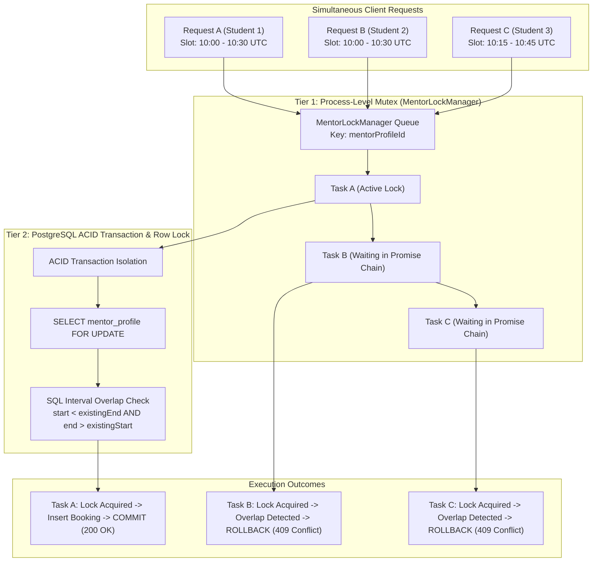

# MentorMaze — Booking Concurrency, Double-Booking Prevention & Timezone Architecture

**Platform:** [MentorMaze](https://mentormaze.aitathastu.com)  
**Parent Organization:** AI Tathastu  
**Canonical Domain:** `https://mentormaze.aitathastu.com`  
**Document Classification:** Engineering Whitepaper & Technical Specification  
**Status:** Validated & Verified in Production  

---

## 1. Concurrency Engineering: The Double-Booking Prevention Proof

In a multi-user mentorship marketplace, concurrent booking attempts for high-demand mentors are frequent. A robust scheduling engine must guarantee that **no two sessions ever overlap on the same mentor**, even when multiple students initiate checkout simultaneously across distributed clients.

MentorMaze implements a **Two-Tier Concurrency Architecture**:



### Mathematical Proof of Interval Overlap

Two time intervals $[A, B)$ and $[C, D)$ (where $A < B$ and $C < D$) overlap if and only if:

$$\text{Overlap}([A, B), [C, D)) \iff (A < D) \land (B > C)$$

In PostgreSQL SQL syntax implemented in `lib/db/booking-service.ts` and `lib/calendar/hold-manager.ts`:

```sql
SELECT id FROM bookings
WHERE mentor_profile_id = $mentorProfileId
  AND status != 'cancelled'
  AND start_time_utc < $requestedEndTimeUtc
  AND end_time_utc > $requestedStartTimeUtc
LIMIT 1;
```

**Proof Cases:**
1. **Existing session ends before requested slot starts:** $B \le C \implies B > C$ is FALSE. No overlap.
2. **Existing session starts after requested slot ends:** $D \le A \implies A < D$ is FALSE. No overlap.
3. **Any intersection (partial overlap, containment, identical window):** Both $A < D$ and $B > C$ evaluate to TRUE. Overlap detected, transaction rejected.

---

## 2. Process-Level Mutex (`MentorLockManager`)

Database row-level locks work effectively, but under heavy burst traffic, dozens of concurrent transactions trying to lock the same row can saturate PostgreSQL connection pools. 

`MentorLockManager` (`lib/db/concurrency.ts`) provides a lightweight, non-blocking in-process mutex queue:

```typescript
export class MentorLockManager {
  private static queues = new Map<string, Promise<void>>();

  static async acquire<T>(mentorId: string, task: () => Promise<T>): Promise<T> {
    const currentQueue = this.queues.get(mentorId) || Promise.resolve();

    let releaseLock!: () => void;
    const nextInQueue = new Promise<void>((resolve) => {
      releaseLock = resolve;
    });

    const queuedTask = currentQueue.then(async () => {
      try {
        return await task();
      } finally {
        releaseLock();
      }
    });

    this.queues.set(mentorId, nextInQueue);

    try {
      return await queuedTask;
    } finally {
      if (this.queues.get(mentorId) === nextInQueue) {
        this.queues.delete(mentorId);
      }
    }
  }
}
```

**Benefits:**
- **Zero Thread Blocking:** Utilizes native JavaScript microtask promise resolution.
- **Fair FIFO Queueing:** Requests execute in the exact order they reach the server.
- **Memory Efficient:** Mutex references are automatically pruned from the Map once all queued tasks complete.

---

## 3. Atomic 10-Minute Checkout Holds

### The Checkout Cart-Race Problem
Without holds, Student A could select a slot, spend 4 minutes entering payment details, only to have Student B book that same slot 5 seconds before Student A submits payment.

### The MentorMaze Hold Solution
When a student selects a slot in `BookingCalendar`:
1. `POST /api/calendar/holds` atomically acquires a temporary hold row in `booking_holds`.
2. The hold is valid for **10 minutes** (`expires_at = NOW() + INTERVAL '10 minutes'`).
3. During this 10-minute window:
   - The slot is marked unavailable (`reason: 'held'`) for all other users.
   - The reserving student sees an active timer badge (`Held for 09:45`).
4. **Idempotency Protection:** The client sends an `idempotencyKey` (e.g. `hold-student1-1773489200000`). If the network disconnects and retries the request, the server returns the existing active hold without creating duplicate reservations.
5. **Consumption:** When payment succeeds, `createBookingInDb` marks the hold as `'converted'` and links the confirmed booking.
6. **Cancellation / Expiry:** If the student leaves checkout, `DELETE /api/calendar/holds/[id]` immediately releases the hold. If 10 minutes elapse, the hold status automatically expires and the slot is restored to public availability.

---

## 4. Timezone & Daylight Saving Time (DST) Architecture

Global mentorship involves students and mentors across dozens of different timezones. Timezone mismanagement leads to missed sessions and double-bookings.

### Absolute UTC Storage Rule
- **Rule 1:** MentorMaze **never** stores dates or times in local formats in PostgreSQL.
- **Rule 2:** All timestamps in `bookings`, `booking_holds`, and `external_calendar_events` are stored in PostgreSQL as `TIMESTAMPTZ` normalized to UTC.
- **Rule 3:** All JSON API requests and responses transmit ISO 8601 UTC strings terminated with `Z` (e.g. `2026-11-20T10:00:00.000Z`).

### IANA Timezone Identifiers
MentorMaze uses standard IANA timezone database identifiers (`Asia/Kolkata`, `America/New_York`, `Europe/London`, `UTC`):
- Avoids ambiguous three-letter abbreviations (e.g. "CST" can mean Central Standard Time in the US, China Standard Time, or Cuba Standard Time).
- Enables automatic handling of Daylight Saving Time (DST) transitions.

### Slot Conversion Mechanics (`SlotGenerator`)
When `SlotGenerator.generateSlots` runs:
1. Candidate slots are generated based on the mentor's recurring schedule and mentor primary timezone (e.g. `Asia/Kolkata`).
2. Each slot start/end is constructed as an absolute UTC `Date`.
3. The slot is formatted for the student using `Intl.DateTimeFormat` with the student's local IANA timezone (`viewerTimezone`).
4. Both UTC (`startTimeUtc`) and formatted local strings (`startTimeLocal`) are returned to the client.

```typescript
// Example: Converting 7:30 PM IST session for a student in New York
// Start Time UTC: 2026-11-20T14:00:00.000Z
// Student in Asia/Kolkata sees:  "7:30 PM"
// Student in America/New_York sees: "9:00 AM"
```

