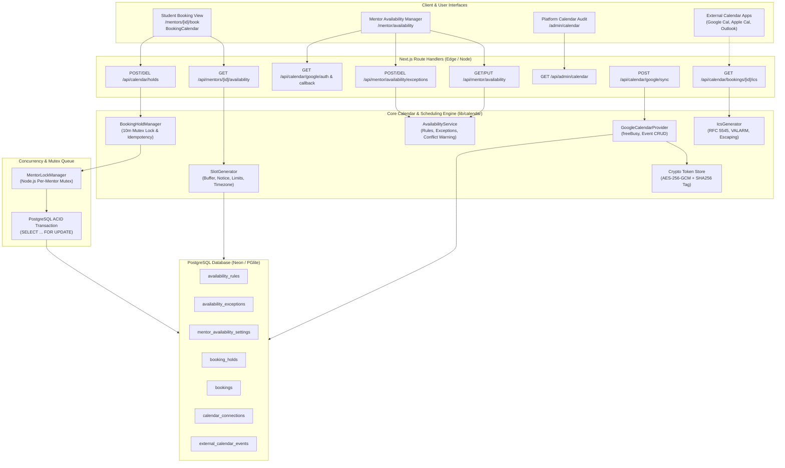
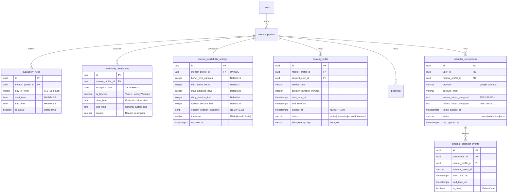
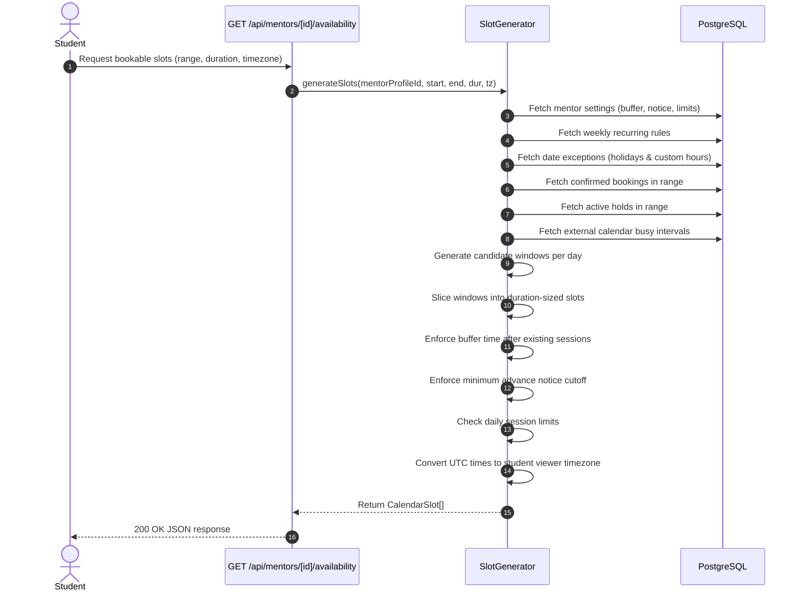
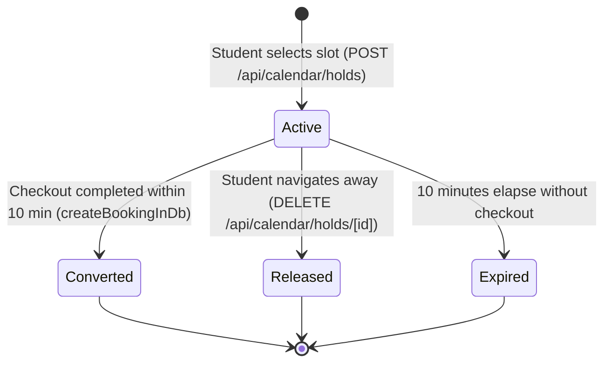

# MentorMaze — Complete Calendar & Scheduling Engine Architecture

**Platform:** [MentorMaze](https://mentormaze.aitathastu.com)  
**Parent Organization:** AI Tathastu  
**Canonical Domain:** `https://mentormaze.aitathastu.com`  
**Document Classification:** Core Infrastructure & System Architecture  
**Status:** Production-Ready  

---

## 1. Executive Summary & Design Principles

The MentorMaze Calendar & Scheduling Engine provides an enterprise-grade, deterministic, and concurrency-safe scheduling infrastructure connecting students and industry mentors. The architecture guarantees zero double-bookings, strict timezone and Daylight Saving Time (DST) accuracy, privacy-preserving two-way external calendar synchronization (Google Calendar), standards-compliant RFC 5545 iCalendar (`.ics`) generation, and temporary slot holds during checkout.

### Core Architectural Axioms

1. **PostgreSQL as Single Source of Truth:** All bookings, holds, recurring availability rules, date exceptions, and external busy caches are persisted in PostgreSQL with absolute UTC timestamps (`TIMESTAMPTZ`).
2. **Two-Tier Concurrency Protection:** Combines an in-process per-mentor mutex queue (`MentorLockManager`) with database-level ACID transactions and row-level locking (`SELECT ... FOR UPDATE`), strictly enforcing `start < B.end AND end > B.start`.
3. **Atomic 10-Minute Checkout Holds:** Prevents cart-racing and checkout collisions by issuing exclusive, idempotent, time-bounded slot holds (`booking_holds`) with automatic expiration cleanup.
4. **Pluggable Calendar Provider Abstraction:** Decoupled `ICalendarProvider` interface allowing seamless addition of Google Calendar, Microsoft 365, and Apple iCloud without touching core booking logic.
5. **Non-Blocking Fault Tolerance:** External calendar failures (network timeout, rate limits, expired tokens) never degrade or block native MentorMaze bookings or user checkout.
6. **Privacy-Preserving Busy Masking:** External calendar events are imported solely as opaque busy intervals (`is_busy: true`); private titles, attendees, and notes from external calendars are never visible to students.

---

## 2. High-Level System Architecture Diagram



---

## 3. Database Schema Entity-Relationship Model (DDL)



---

## 4. Concurrency & Double-Booking Prevention Mechanics

The system guarantees that under high concurrency (e.g. 20 simultaneous students attempting to book the identical slot), exactly one request succeeds and all conflicting requests are rejected with a deterministic HTTP 409 Conflict.

### Two-Tier Concurrency Architecture

1. **Process-Level Mutex (`MentorLockManager`):**
   - Implemented in `lib/db/concurrency.ts`.
   - Uses an asynchronous promise-chaining queue keyed by `mentorProfileId`.
   - Serializes concurrent Node.js async operations targeting the same mentor, eliminating thread contention and race conditions before touching database connection pools.

2. **Database-Level Row Locking (`SELECT ... FOR UPDATE`):**
   - Inside an ACID transaction (`db.transaction`), the mentor profile row is locked with `FOR UPDATE`.
   - An interval overlap check executes in PostgreSQL:
     $$\text{Overlap} \iff (\text{newStart} < \text{existingEnd}) \land (\text{newEnd} > \text{existingStart})$$
   - Confirmed bookings (`status != 'cancelled'`), active unexpired holds (`status = 'active' AND expires_at > NOW()`), and external busy events (`is_busy = true`) are evaluated atomically.
   - If overlap occurs, transaction rolls back immediately with `{ success: false, collision: true }`.

---

## 5. Slot Generation Algorithm

The slot calculation workflow (`SlotGenerator.generateSlots`) executes in five distinct stages:



---

## 6. Temporary Booking Hold Lifecycle



1. **Reservation:** Student taps an available slot. The frontend initiates `POST /api/calendar/holds` with an idempotency key.
2. **Locking:** The backend creates a row in `booking_holds` with `status = 'active'` and `expires_at = NOW() + 10 minutes`.
3. **Countdown:** The frontend UI renders an active hold countdown pill (`Held for 09:45`). Other students see this slot as unavailable (`reason: 'held'`).
4. **Completion:** Upon successful payment or confirmation, `consumeHold` marks the hold as `'converted'` and links the confirmed booking.
5. **Expiration:** If the timer reaches zero, the background cleanup worker marks the hold as `'expired'`, automatically freeing the slot.

---

## 7. Google Calendar Integration & Cryptographic Storage

### Modular Interface (`ICalendarProvider`)
The core booking system interacts only with `ICalendarProvider`:
```typescript
export interface ICalendarProvider {
  readonly providerName: "google_calendar" | "microsoft_365";
  fetchFreeBusy(startTimeUtc: Date, endTimeUtc: Date): Promise<ExternalBusyInterval[]>;
  createEvent(booking: BookingCalendarPayload): Promise<{ externalEventId: string; htmlLink?: string } | null>;
  updateEvent(externalEventId: string, booking: BookingCalendarPayload): Promise<{ externalEventId: string } | null>;
  deleteEvent(externalEventId: string): Promise<boolean>;
}
```

### Cryptographic Security (AES-256-GCM)
- OAuth refresh tokens are sensitive secrets. Storing them in plaintext violates production security standards.
- Every token is encrypted via `encryptToken` in `lib/calendar/crypto.ts` using AES-256-GCM with a unique 96-bit random IV and 128-bit authentication tag.
- Formatted as `iv:tag:ciphertext`. Any tampering with the ciphertext causes decryption failure and authentication rejection.

---

## 8. RFC 5545 iCalendar (`.ics`) Implementation

The `.ics` generator (`lib/calendar/ics-generator.ts`) implements RFC 5545 standard calendar objects compatible with Google Calendar, Apple Calendar, and Microsoft Outlook:

- **MIME Type:** `text/calendar; charset=utf-8`
- **Content Disposition:** `attachment; filename="mentormaze-session-<id>.ics"`
- **Required Fields:** `BEGIN:VCALENDAR`, `VERSION:2.0`, `PRODID`, `METHOD:REQUEST`, `BEGIN:VEVENT`, `UID`, `STATUS`, `DTSTART`, `DTEND`, `SUMMARY`, `DESCRIPTION`, `LOCATION`, `URL`, `ORGANIZER`, `ATTENDEE`.
- **Integrated Reminder Alarm:** Includes a `BEGIN:VALARM` component with `TRIGGER:-PT15M` alerting the student and mentor 15 minutes prior to the live video session.
- **Line Endings:** RFC 5545 requires CRLF (`\r\n`) line terminations.

