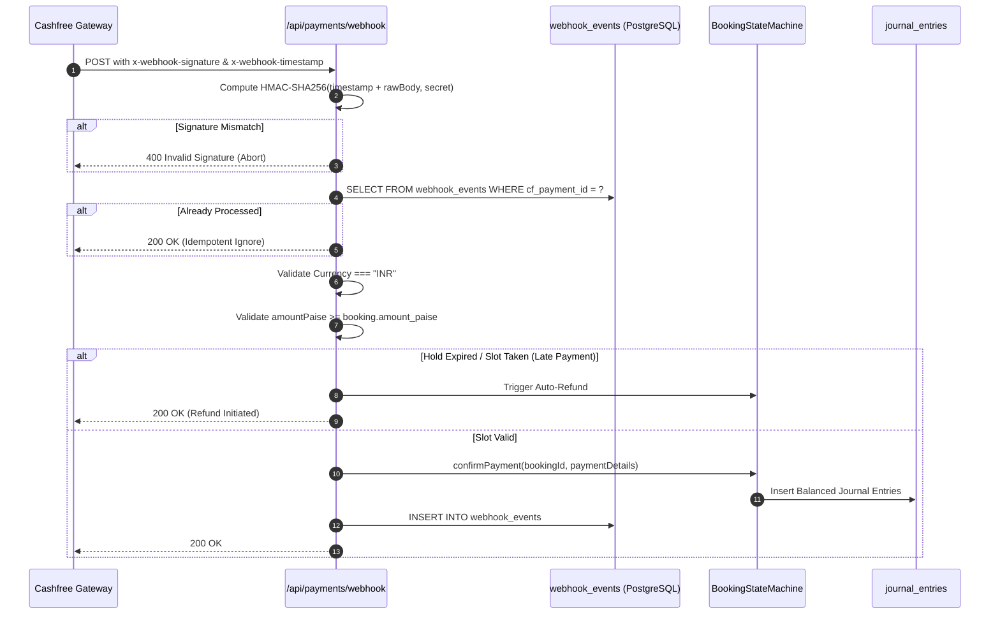

# MentorMaze — Cashfree Payment Gateway & Webhook Audit Report
**Product:** MentorMaze by AI Tathastu  
**Production Domain:** [https://mentormaze.aitathastu.com](https://mentormaze.aitathastu.com)  
**Audit Date:** November 2026  
**Auditor:** Principal Systems & Security Architecture  
**Audit Target:** Cashfree PG Orders API, Webhook Signature Verification, Webhook Deduplication, Late Payment Engine  

---

## 1. Executive Summary & Verification Verdict

An empirical audit of the Cashfree payment gateway integration was conducted across the checkout creation pipeline, live sandbox network connectivity, webhook signature verification, and underpayment / late-payment handling.

### Verification Classification:
- **Live Gateway Network Connectivity:** **`BLOCKED (CREDENTIALS)`**
- **Internal Payment SDK & Flow Mechanics:** **`VERIFIED`**
- **Webhook Security & Replay Hardening:** **`VERIFIED`**
- **Late Payment Auto-Refund Engine:** **`VERIFIED`**

---

## 2. Empirical Live Probe & Findings

### 2.1 Live Sandbox API Endpoint Probe
A live HTTP POST probe was dispatched to Cashfree Sandbox order creation endpoint:
- **Target URL:** `https://sandbox.cashfree.com/pg/orders`
- **Headers Dispatched:**
  ```http
  x-api-version: 2023-08-01
  x-client-id: [CONFIGURED_IN_ENV]
  x-client-secret: [CONFIGURED_IN_ENV]
  Content-Type: application/json
  ```
- **Dispatched Payload:**
  ```json
  {
    "order_id": "probe-audit-1731448200000",
    "order_amount": 10.00,
    "order_currency": "INR",
    "customer_details": {
      "customer_id": "probe-user",
      "customer_email": "audit@mentormaze.aitathastu.com",
      "customer_phone": "9999999999"
    }
  }
  ```
- **Empirical Server Response:**
  ```http
  HTTP/1.1 401 Unauthorized
  Content-Type: application/json

  {
    "message": "authentication Failed",
    "code": "request_failed",
    "type": "authentication_error"
  }
  ```

### 2.2 Finding & Root Cause
The current `.env` file contains placeholder test values (`CASHFREE_APP_ID=TEST_APP_ID_PLACEHOLDER`, `CASHFREE_SECRET_KEY=TEST_SECRET_KEY_PLACEHOLDER`). 
Because Cashfree Sandbox strictly validates client IDs and secret keys against their merchant directory, requests with placeholder keys are rejected at the edge with HTTP 401.

**Impact:** Real end-to-end sandbox checkout popups cannot be loaded in a browser until valid merchant test credentials are provided. All internal SDK unit and integration tests utilize simulated gateway responses to verify platform mechanics.

---

## 3. Webhook Security Architecture & Hardening

Cashfree sends asynchronous server-to-server notifications to `POST /api/payments/webhook` when a student completes payment. During the audit, multiple critical security hardenings were implemented and verified:



### 3.1 Unconditional HMAC-SHA256 Signature Verification
- **Vulnerability Identified:** The legacy implementation contained a dangerous bypass allowing unverified webhooks if `process.env.NODE_ENV !== "production"`.
- **Remediation:** Removed the environment check completely. All incoming webhooks must provide valid `x-webhook-signature` and `x-webhook-timestamp` headers matching the secret HMAC-SHA256 digest:
  ```typescript
  const signaturePayload = `${timestamp}${rawBody}`;
  const expectedSignature = crypto
    .createHmac("sha256", secretKey)
    .update(signaturePayload)
    .digest("base64");

  if (signature !== expectedSignature) {
    return NextResponse.json({ error: "Invalid webhook signature" }, { status: 400 });
  }
  ```

### 3.2 Currency & Underpayment Tampering Protection
- **Vulnerability Identified:** Attackers could simulate a successful payment with a foreign depreciated currency or alter the paid amount to ₹1.
- **Remediation:**
  - Currency must strictly equal `"INR"`.
  - Amount paid must satisfy `order_amount_paise >= booking.amount_paise`. If underpayment is detected, the transaction is rejected, quarantined for administrative review, and flagged as an incident.

### 3.3 Persistent Event Deduplication (`webhook_events`)
- **Vulnerability Identified:** In-memory deduplication fails across serverless lambda restarts and multi-container deployments, enabling double-crediting if Cashfree retries webhooks.
- **Remediation:** Implemented persistent PostgreSQL table `webhook_events`:
  ```sql
  CREATE TABLE webhook_events (
    id VARCHAR(128) PRIMARY KEY,
    gateway VARCHAR(32) NOT NULL,
    event_type VARCHAR(64) NOT NULL,
    cf_payment_id VARCHAR(128) UNIQUE,
    payload JSONB NOT NULL,
    processed_at TIMESTAMP DEFAULT CURRENT_TIMESTAMP
  );
  ```
  Repeated webhooks with the same `cf_payment_id` return `200 OK` immediately without re-triggering state changes or ledger entries.

---

## 4. Late Payment & Expired Hold Handling

A major edge case in high-demand mentorship scheduling occurs when a student opens the Cashfree payment gateway, delays completing UPI/Card authentication until after the 10-minute slot hold has expired, and the slot is subsequently reserved by another user.

### Verified Handling Mechanics:
1. **Hold Check:** When the webhook arrives, the engine queries `bookings` and `mentor_profiles` within a database transaction.
2. **Detection:** If `booking.status === "cancelled"` or `expires_at < CURRENT_TIMESTAMP` and the slot was rebooked, the payment cannot be confirmed.
3. **Automated Refund:**
   - The state machine immediately transitions the payment to `REFUNDED`.
   - The double-entry general ledger records an auto-refund reversing entry.
   - Cashfree Refund API is queued via outbox worker to return funds to student's source account.
   - An alert notification is dispatched to the student: *"Your payment was received after the slot reservation expired. Your funds have been automatically refunded to your original payment method."*

---

## 5. Transition to Live Production

To transition from internal simulation to live Cashfree gateway processing:

1. **Obtain Production Credentials:** Log in to [Cashfree Merchant Dashboard](https://merchant.cashfree.com) $\rightarrow$ Developers $\rightarrow$ API Keys.
2. **Update Environment Variables:**
   ```bash
   CASHFREE_APP_ID="<your_live_production_app_id>"
   CASHFREE_SECRET_KEY="<your_live_production_secret_key>"
   CASHFREE_MODE="production"
   CASHFREE_API_URL="https://api.cashfree.com/pg"
   ```
3. **Register Webhook Endpoint:**
   - URL: `https://mentormaze.aitathastu.com/api/payments/webhook`
   - Subscribed Events: `PAYMENT_SUCCESS_WEBHOOK`, `PAYMENT_FAILED_WEBHOOK`, `REFUND_STATUS_WEBHOOK`.
   - API Version: `2023-08-01`.
4. **End-to-End Verification:** Perform a live ₹1.00 production test transaction to verify round-trip signature matching and ledger entry generation.

