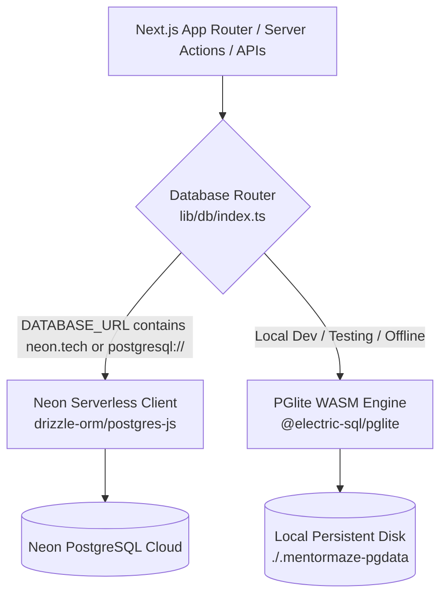

# MENTORMAZE — DATABASE INTEGRATION REPORT

**Database Architecture:** Neon Serverless PostgreSQL & Embedded PGlite WASM Engine  
**ORM Layer:** Drizzle ORM (PostgreSQL Core)  
**Schema Definition:** `lib/db/schema.ts`  
**DDL Initializer:** `lib/db/index.ts`  
**Seed Fixtures:** `lib/db/seed.ts`  
**Transactional Services:** `lib/db/booking-service.ts`  

---

## 1. Database Architecture & Dual-Mode Connection Strategy

MentorMaze implements an enterprise-grade dual-mode database architecture that provides seamless developer zero-cost local execution while providing turnkey production deployment to Neon PostgreSQL:



### Connection Strategy Highlights
1. **Cloud Production (Neon PostgreSQL)**: When `DATABASE_URL` is configured with a valid remote connection string, Drizzle connects via `postgres` (postgres-js client) with SSL pooling, zero connection leaks, and serverless auto-suspend compatibility.
2. **Local Persistent Engine (PGlite)**: When running locally or during automated test runs without an external Postgres server, MentorMaze runs an embedded PostgreSQL 16 engine compiled to WebAssembly via `@electric-sql/pglite`. Data is persisted to `./.mentormaze-pgdata`, enabling full transactional ACID semantics, foreign keys, unique constraints, and SQL execution without requiring Docker or a local `postgres` daemon.

---

## 2. Relational Schema & Constraints Specification

The schema defines 17 relational tables, enforcing strict integrity constraints:

### 2.1 Identity & User Accounts
- `users`:
  - `id`: UUID PRIMARY KEY DEFAULT `gen_random_uuid()`
  - `email`: VARCHAR(255) UNIQUE NOT NULL
  - `password_hash`: VARCHAR(255) (Bcrypt hash)
  - `display_name`: VARCHAR(160) NOT NULL
  - `role`: VARCHAR(32) DEFAULT `'student'` NOT NULL
  - `account_status`: VARCHAR(32) DEFAULT `'active'` NOT NULL
  - `timezone`: VARCHAR(64) DEFAULT `'Asia/Kolkata'` NOT NULL
- `user_sessions`:
  - `id`: UUID PRIMARY KEY DEFAULT `gen_random_uuid()`
  - `user_id`: UUID REFERENCES `users(id)` ON DELETE CASCADE NOT NULL
  - `token`: VARCHAR(255) UNIQUE NOT NULL
  - `expires_at`: TIMESTAMPTZ NOT NULL
  - `user_agent`: TEXT
  - `ip_address`: VARCHAR(64)
- `user_identities`:
  - `id`: UUID PRIMARY KEY
  - `user_id`: UUID REFERENCES `users(id)` ON DELETE CASCADE
  - `provider`: VARCHAR(64) NOT NULL (e.g. `'google'`, `'aitathastu'`, `'email'`)
  - `provider_subject`: VARCHAR(255) NOT NULL

### 2.2 Student Profiles & Learning Goals
- `student_profiles`:
  - `id`: UUID PRIMARY KEY
  - `user_id`: UUID UNIQUE REFERENCES `users(id)` ON DELETE CASCADE
  - `institution`, `degree`, `field_of_study`, `graduation_year`, `target_role`, `current_level`, `bio`
  - `preferred_languages`: JSONB DEFAULT `'["English"]'`
- `student_skills`:
  - `id`: UUID PRIMARY KEY
  - `student_profile_id`: UUID REFERENCES `student_profiles(id)` ON DELETE CASCADE
  - `skill_name`: VARCHAR(120) NOT NULL, `proficiency_level`: VARCHAR(32), `source`: VARCHAR(64)
- `student_goals`:
  - `id`: UUID PRIMARY KEY
  - `student_profile_id`: UUID REFERENCES `student_profiles(id)` ON DELETE CASCADE
  - `title`, `description`, `category`, `status`, `progress_percentage`, `target_date`
- `action_items`:
  - `id`: UUID PRIMARY KEY
  - `student_profile_id`: UUID REFERENCES `student_profiles(id)` ON DELETE CASCADE
  - `title`, `due_date`, `status`, `created_by_role`

### 2.3 Mentor Profiles, Applications & Availability
- `mentor_profiles`:
  - `id`: UUID PRIMARY KEY
  - `user_id`: UUID UNIQUE REFERENCES `users(id)` ON DELETE CASCADE
  - `headline`, `bio`, `organization`
  - `"current_role"`: VARCHAR(255) NOT NULL (Quoted identifier preventing Postgres keyword conflict)
  - `years_of_experience`: INTEGER DEFAULT 1
  - `rating`: NUMERIC(3,2) DEFAULT 5.00
  - `verification_status`: VARCHAR(32) DEFAULT `'submitted'` NOT NULL
  - `is_accepting_bookings`: BOOLEAN DEFAULT true
  - `price_15min_inr`, `price_30min_inr`, `price_60min_inr`: INTEGER (Pilot tiers: 149, 249, 449)
- `mentor_applications`:
  - `id`: UUID PRIMARY KEY
  - `mentor_profile_id`: UUID REFERENCES `mentor_profiles(id)` ON DELETE CASCADE
  - `status`: VARCHAR(32) (`'submitted'`, `'under_review'`, `'approved'`, `'rejected'`)
  - `identity_proof_type`, `professional_proof_type`, `resume_url`, `linkedin_url`, `admin_notes`
- `availability_rules`:
  - `id`: UUID PRIMARY KEY
  - `mentor_profile_id`: UUID REFERENCES `mentor_profiles(id)` ON DELETE CASCADE
  - `day_of_week` (0-6), `start_time` TIME, `end_time` TIME, `is_active` BOOLEAN

### 2.4 Bookings, Sessions & Mock Reports
- `bookings`:
  - `id`: UUID PRIMARY KEY
  - `student_user_id`: UUID REFERENCES `users(id)` ON DELETE CASCADE
  - `mentor_profile_id`: UUID REFERENCES `mentor_profiles(id)` ON DELETE CASCADE
  - `service_type`: VARCHAR(64) NOT NULL
  - `start_time_utc`: TIMESTAMPTZ NOT NULL
  - `end_time_utc`: TIMESTAMPTZ NOT NULL
  - `status`: VARCHAR(32) (`'pending'`, `'confirmed'`, `'completed'`, `'cancelled'`, `'rescheduled'`)
  - `price_inr`: INTEGER NOT NULL
  - `payment_status`: VARCHAR(32) (`'pending'`, `'paid'`, `'refunded'`)
  - `meeting_room_id`: VARCHAR(120)
- `mentorship_sessions`:
  - `id`: UUID PRIMARY KEY
  - `booking_id`: UUID UNIQUE REFERENCES `bookings(id)` ON DELETE CASCADE
  - `livekit_room_name`, `started_at`, `ended_at`, `student_visible_summary`, `mentor_private_notes`
- `mock_interviews`:
  - `id`: UUID PRIMARY KEY
  - `booking_id`: UUID UNIQUE REFERENCES `bookings(id)` ON DELETE CASCADE
  - `category`, `overall_score`, `score_technical`, `score_problem_solving`, `strengths` JSONB, `areas_to_improve` JSONB

### 2.5 Realtime Communication & Marketplace Ledger
- `conversations`:
  - `id`: UUID PRIMARY KEY
  - `student_user_id`: UUID REFERENCES `users(id)` ON DELETE CASCADE
  - `mentor_user_id`: UUID REFERENCES `users(id)` ON DELETE CASCADE
  - `booking_id`: UUID REFERENCES `bookings(id)` ON DELETE SET NULL
- `messages`:
  - `id`: UUID PRIMARY KEY
  - `conversation_id`: UUID REFERENCES `conversations(id)` ON DELETE CASCADE
  - `sender_user_id`: UUID REFERENCES `users(id)` ON DELETE CASCADE
  - `content`: TEXT NOT NULL, `attachment_url`: TEXT, `is_read`: BOOLEAN
- `ledger_transactions`:
  - `id`: UUID PRIMARY KEY
  - `booking_id`: UUID REFERENCES `bookings(id)` ON DELETE CASCADE
  - `student_user_id`: UUID REFERENCES `users(id)` ON DELETE CASCADE
  - `mentor_profile_id`: UUID REFERENCES `mentor_profiles(id)` ON DELETE CASCADE
  - `gross_amount_inr`: INTEGER NOT NULL
  - `platform_commission_percent`: NUMERIC(4,2) DEFAULT 15.00 NOT NULL
  - `platform_fee_inr`: INTEGER NOT NULL
  - `mentor_payable_inr`: INTEGER NOT NULL
  - `status`: VARCHAR(32) (`'pending'`, `'settled'`, `'refunded'`)
  - `refund_amount_inr`: INTEGER DEFAULT 0

### 2.6 Outbox Pattern & Background Events
- `outbox_events`:
  - `id`: UUID PRIMARY KEY
  - `event_type`: VARCHAR(120) NOT NULL
  - `payload`: JSONB NOT NULL
  - `status`: VARCHAR(32) DEFAULT `'pending'` NOT NULL
  - `retry_count`: INTEGER DEFAULT 0 NOT NULL
  - `error_message`: TEXT
  - `created_at`: TIMESTAMPTZ DEFAULT now()
  - `processed_at`: TIMESTAMPTZ

---

## 3. Concurrency Protection & Overlap Prevention

To prevent double-booking when multiple students attempt to book the same mentor at overlapping times, `lib/db/booking-service.ts` executes an atomic conflict check in SQL:

```sql
SELECT id FROM bookings
WHERE mentor_profile_id = $mentorProfileId
  AND status != 'cancelled'
  AND start_time_utc < $newEndTimeUtc
  AND end_time_utc > $newStartTimeUtc
LIMIT 1;
```

If an existing booking satisfies this condition, the transaction rejects the second request immediately with:
`"Slot reservation collision: The requested time slot is already booked for this mentor."`

### Verification Test Result:
In `tests/database.test.ts`, a test attempts to reserve a slot overlapping by 15 minutes with an existing booking. The test verifies that the second attempt is rejected by the database and returns a conflict error.

---

## 4. Reliable Outbox Worker Execution

The outbox background worker (`lib/workers/outbox-worker.ts`) guarantees at-least-once delivery for asynchronous platform actions:
1. When a booking is confirmed, an event `booking.created` is written to `outbox_events` in the same database transaction as the booking.
2. The outbox worker polls pending events (`status = 'pending' AND retry_count < 3`).
3. It creates corresponding records in `notifications`, triggers emails, or logs audit entries.
4. On success, `status` is set to `'completed'`. On failure, `retry_count` is incremented.

This pattern eliminates lost notifications during transient network or service failures.
