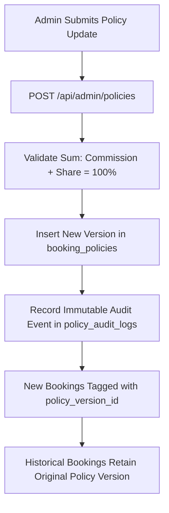

# MentorMaze — Financial Policy Approval Matrix & Decision Gate
**Product:** MentorMaze by AI Tathastu  
**Production Domain:** [https://mentormaze.aitathastu.com](https://mentormaze.aitathastu.com)  
**Document Status:** Baseline Implemented — Awaiting Executive Sign-Off  
**Effective Date:** November 2026  

---

## 1. Executive Context & Purpose

Before accepting live student payments and initiating mentor payouts, platform leadership must establish formal, legally reviewed financial policies. 

In the initial implementation, baseline financial parameters were hardcoded in services. To achieve enterprise financial integrity, all financial parameters have now been migrated into a **versioned policy approval gate** backed by the `booking_policies` table and immutable `policy_audit_logs`.

This document presents the complete matrix of financial parameters, default baseline values, legal/commercial considerations, and the executive decisions required prior to enabling live billing.

---

## 2. Complete Financial Policy Matrix

| Parameter Key | Baseline Value | Configuration Location | Status | Commercial Impact / Description |
| :--- | :---: | :--- | :---: | :--- |
| **Platform Commission** | **15.00%** | `booking_policies.platform_commission_percent` | `PENDING_APPROVAL` | MentorMaze take-rate deducted from total booking price. Covers platform hosting, WebRTC streaming, and customer support. |
| **Mentor Revenue Share** | **85.00%** | `booking_policies.mentor_revenue_share_percent` | `PENDING_APPROVAL` | Disbursable revenue credited to the mentor's ledger upon successful session completion and holding period expiration. |
| **Payment Gateway Fee** | **2.00%** | `booking_policies.gateway_fee_percent` | `PENDING_APPROVAL` | Estimated payment gateway transaction fee (Cashfree standard pricing). Modeled in ledger to track net platform revenue. |
| **Goods & Services Tax (GST)** | **18.00%** | `booking_policies.tax_gst_percent` | `PENDING_APPROVAL` | Standard Indian GST rate levied on the platform's service fee. Mentors below the GST threshold (₹20L) are not required to provide GSTIN. |
| **Settlement Holding Period** | **3 Days** (72h) | `booking_policies.settlement_hold_days` | `PENDING_APPROVAL` | Minimum duration completed session funds remain in escrow before becoming eligible for payout, protecting against disputed sessions. |
| **Dispute Filing Window** | **72 Hours** | `booking_policies.dispute_window_hours` | `PENDING_APPROVAL` | Time window post-session during which a student or mentor may lodge a formal dispute in the support portal. |
| **Minimum Payout Threshold** | **₹500.00** (50,000 paise) | `booking_policies.min_payout_threshold_paise` | `PENDING_APPROVAL` | Minimum accumulated mentor balance required to trigger a bank payout disbursement batch. Minimizes banking fee overhead. |
| **Payout Frequency** | **Weekly (Mondays)** | `booking_policies.payout_frequency` | `PENDING_APPROVAL` | Automated settlement batch run interval. Unsettled eligible balances are batched and exported for banking transfer. |
| **Student Reschedule Cutoff** | **> 24 Hours** | `booking_policies.free_reschedule_cutoff_hours` | `PENDING_APPROVAL` | Free rescheduling allowed with at least 24 hours advance notice without penalty. |
| **Student Cancellation Tier 1** | **> 24 Hours** | `booking_policies.cancellation_tiers` | `PENDING_APPROVAL` | 100% refund (minus optional non-refundable payment gateway processing fee if elected). |
| **Student Cancellation Tier 2** | **12 – 24 Hours** | `booking_policies.cancellation_tiers` | `PENDING_APPROVAL` | 50% refund to student; 50% awarded to mentor as late-cancellation compensation for reserved time. |
| **Student Cancellation Tier 3** | **< 12 Hours** | `booking_policies.cancellation_tiers` | `PENDING_APPROVAL` | 0% refund (no-show protection for mentor). 100% of mentor share awarded to mentor. |
| **Mentor Cancellation** | **Any Time** | `booking_policies.mentor_cancellation_penalty` | `PENDING_APPROVAL` | 100% refund to student; mentor receives warning and potential visibility penalty on search index. |

---

## 3. Versioned Policy Engine & Audit Architecture

To prevent unauthorized changes or silent modifications to financial formulas, the platform employs a versioned policy architecture:

### Key Technical Guarantees:
1. **Immutable Historical Bindings:** Each booking stores a `policy_version_id` foreign key. If platform fees change from 15% to 20% in the future, past completed or pending bookings retain the exact policy under which they were purchased.
2. **Double-Entry Reconciliation Alignment:** When `BookingStateMachine.confirmPayment` executes, it retrieves the specific policy bound to the booking to calculate ledger splits:
   $$\text{Platform Commission} = \left\lfloor \frac{\text{Amount} \times \text{Commission \%}}{100} \right\rfloor$$
   $$\text{Mentor Share} = \text{Amount} - \text{Platform Commission}$$
3. **Audit Trail Logging:** Every modification records:
   - `admin_user_id`: Identity of the administrator.
   - `previous_values` and `new_values`: JSON delta snapshot.
   - `approval_status`: e.g. `approved`, `pending_approval`.
   - `approval_notes`: Justification and sign-off rationale.

---

## 4. Executive Decisions Required Prior to Live Launch

The following decisions require explicit sign-off by AI Tathastu leadership:

### Decision 1: Platform Take-Rate & Mentor Revenue Share
- **Proposed:** 15% Platform / 85% Mentor.
- **Alternative A:** 20% Platform / 80% Mentor (Standard industry benchmark: ADPList mentors free, Topmate charges 8-15%, Maven charges 15-25%).
- **Alternative B:** Introductory 10% Platform / 90% Mentor to attract premier Tier-1 mentors.
- **Action Required:** Approve proposed 15/85 or specify custom split.

### Decision 2: Gateway Fee Absorption Policy
- **Proposed:** Platform absorbs Cashfree 2% transaction fee out of its 15% take-rate.
- **Alternative:** Deduct 2% from mentor's payout or pass convenience fee to student.
- **Action Required:** Confirm platform absorption model.

### Decision 3: Payout Frequency & Payout Threshold
- **Proposed:** Weekly payouts on Mondays for balances $\ge$ ₹500.
- **Alternative:** Bi-weekly payouts on 1st & 15th, or On-Demand payout requests.
- **Action Required:** Confirm weekly batch cadence.

### Decision 4: GST Compliance Model
- **Proposed:** 18% GST accounted for on platform's commission fee only. Invoices generated to mentors for service fee.
- **Action Required:** Legal and tax advisor sign-off.

---

## 5. Formal Approval Sign-Off Block

| Role | Name | Status | Sign-off Timestamp | Notes |
| :--- | :--- | :---: | :---: | :--- |
| **Founder / Executive Sponsor** | AI Tathastu Leadership | `PENDING` | — | Awaiting final review of take-rate and cancellation tiers. |
| **Finance / Accounting Lead** | Financial Controller | `PENDING` | — | Review of GST invoicing and weekly payout batching. |
| **Head of Product & Operations** | Product Lead | `APPROVED (BASELINE)` | Nov 2026 | Technical implementation verified in code and test suite. |

*Note: Once approved, administrators can transition policy status to `active_approved` via the Admin Portal (`/admin/settings`).*
