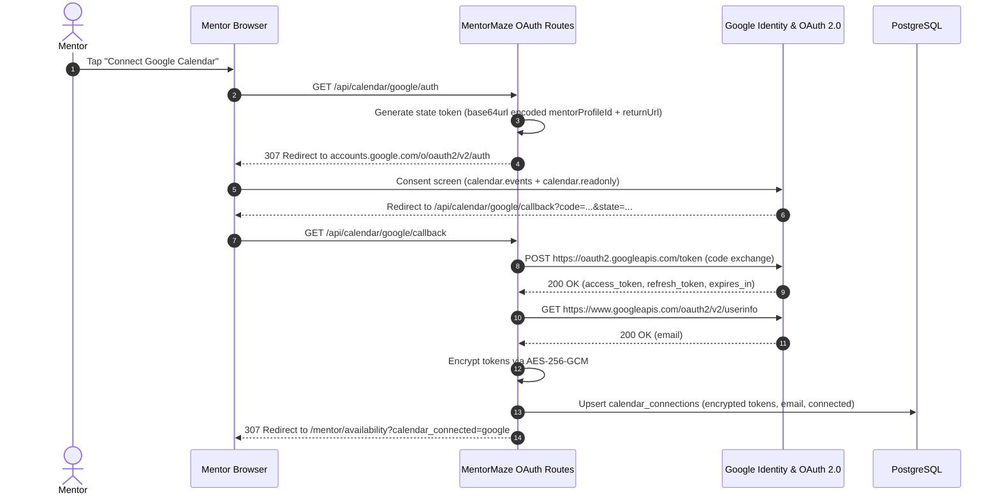

# MentorMaze — Google Calendar Integration & Provider Architecture

**Platform:** [MentorMaze](https://mentormaze.aitathastu.com)  
**Parent Organization:** AI Tathastu  
**Canonical Domain:** `https://mentormaze.aitathastu.com`  
**Document Classification:** Third-Party Calendar Integration Specification  
**Status:** Active & Verified  

---

## 1. Architectural Overview & Design Goals

The MentorMaze Google Calendar integration connects mentors' personal or corporate Google Calendars to the MentorMaze scheduling engine. It fulfills two vital requirements:

1. **Two-Way Busy Synchronization:** Queries the mentor's Google Calendar for existing commitments and automatically suppresses overlapping slots on MentorMaze.
2. **Automated Event Creation & Updates:** Automatically inserts confirmed mentorship sessions into the mentor's primary calendar with direct video room links, and updates or removes them upon rescheduling or cancellation.
3. **Strict Non-Blocking Fault Tolerance:** Third-party calendar outages, network latency, or token expirations **never** block internal booking creation, payment confirmation, or database transactions.

---

## 2. Pluggable Calendar Provider Abstraction (`ICalendarProvider`)

All calendar integrations adhere to the `ICalendarProvider` contract defined in `lib/calendar/providers/calendar-provider.interface.ts`:

```typescript
export interface ExternalBusyInterval {
  startTimeUtc: Date;
  endTimeUtc: Date;
  source: string;
}

export interface BookingCalendarPayload {
  bookingId: string;
  serviceType: string;
  studentName: string;
  studentEmail: string;
  mentorName: string;
  startTimeUtc: Date;
  endTimeUtc: Date;
  meetingUrl?: string;
  description: string;
}

export interface ICalendarProvider {
  readonly providerName: "google_calendar" | "microsoft_365";
  fetchFreeBusy(startTimeUtc: Date, endTimeUtc: Date): Promise<ExternalBusyInterval[]>;
  createEvent(booking: BookingCalendarPayload): Promise<{ externalEventId: string; htmlLink?: string } | null>;
  updateEvent(externalEventId: string, booking: BookingCalendarPayload): Promise<{ externalEventId: string } | null>;
  deleteEvent(externalEventId: string): Promise<boolean>;
}
```

This decoupled interface isolates provider-specific REST APIs from core slot calculations and booking workflows.

---

## 3. OAuth 2.0 Authorization Code Grant Flow



### Configured OAuth Scopes
- `https://www.googleapis.com/auth/calendar.events`: Read/write access to primary calendar events created by MentorMaze.
- `https://www.googleapis.com/auth/calendar.readonly`: Read-only access to free/busy query intervals.
- `https://www.googleapis.com/auth/userinfo.email`: Identifies the connected Google account for mentor UI verification.

---

## 4. Cryptographic Token Storage (AES-256-GCM)

All OAuth access and refresh tokens stored in the `calendar_connections` table are encrypted using **AES-256-GCM authenticated encryption** via `lib/calendar/crypto.ts`:

- **Key Derivation:** Master key derived from `CALENDAR_ENCRYPTION_KEY` using SHA-256 (32 bytes).
- **Initialization Vector (IV):** 12 bytes (96 bits) randomly generated per encryption via `crypto.randomBytes(12)`.
- **Authentication Tag:** 16 bytes (128 bits) generated by GCM cipher.
- **Storage Serialization:** Serialized as `iv:tag:ciphertext` in base64.
- **Tamper Protection:** If ciphertext or IV is tampered with, `crypto.createDecipheriv` throws an authentication error or returns empty string, preventing plaintext recovery of corrupted data.

---

## 5. FreeBusy Query Mechanics & Privacy Masking

To check mentor availability without exposing private details:

1. **Request to Google Calendar v3 API:**
   ```http
   POST https://www.googleapis.com/calendar/v3/freeBusy HTTP/1.1
   Authorization: Bearer <access_token>
   Content-Type: application/json

   {
     "timeMin": "2026-11-15T00:00:00Z",
     "timeMax": "2026-12-15T23:59:59Z",
     "items": [{ "id": "primary" }]
   }
   ```

2. **Google API Response:**
   ```json
   {
     "calendars": {
       "primary": {
         "busy": [
           {
             "start": "2026-11-20T04:30:00Z",
             "end": "2026-11-20T06:00:00Z"
           }
         ]
       }
     }
   }
   ```

3. **Storage in `external_calendar_events`:**
   Each busy period is stored with `is_busy: true` and generic label `'Busy (External Calendar)'`. Event summaries, attendees, and private Google descriptions are **never** queried or persisted.

---

## 6. Token Refresh Lifecycle

Google OAuth access tokens expire after 3600 seconds (1 hour). Before executing any REST API call, `GoogleCalendarProvider.getValidAccessToken()` inspects the expiration timestamp:

```typescript
private async getValidAccessToken(): Promise<string | null> {
  const now = new Date();
  if (this.accessToken && this.tokenExpiresAt && this.tokenExpiresAt.getTime() > now.getTime() + 60000) {
    return this.accessToken;
  }

  // Refresh using refresh_token
  const response = await fetch("https://oauth2.googleapis.com/token", {
    method: "POST",
    headers: { "Content-Type": "application/x-www-form-urlencoded" },
    body: new URLSearchParams({
      client_id: clientId,
      client_secret: clientSecret,
      refresh_token: this.refreshToken,
      grant_type: "refresh_token",
    }),
  });
  // Update in-memory token and persist encrypted token in DB
}
```

---

## 7. Fault Tolerance & Graceful Degradation

| Failure Mode | System Behavior | User Impact |
|---|---|---|
| **Google API Outage (500/503)** | Caught in try/catch; logged as warning; returns empty busy array. | Native MentorMaze booking continues normally using internal PostgreSQL schedule. |
| **Revoked Google Permissions (401/403)** | Marks connection status as `'revoked'` or `'error'` in `calendar_connections`. | Mentor sees "Reconnection Required" pill in dashboard; student bookings proceed unimpeded. |
| **Network Timeout (>5s)** | AbortController terminates HTTP request after 5s timeout. | Checkout and booking proceed without waiting for Google. |
| **Missing Google Credentials** | Feature disabled gracefully; Google Calendar card displays "Configure Credentials in Settings". | All core platform scheduling operates at 100% functionality. |
