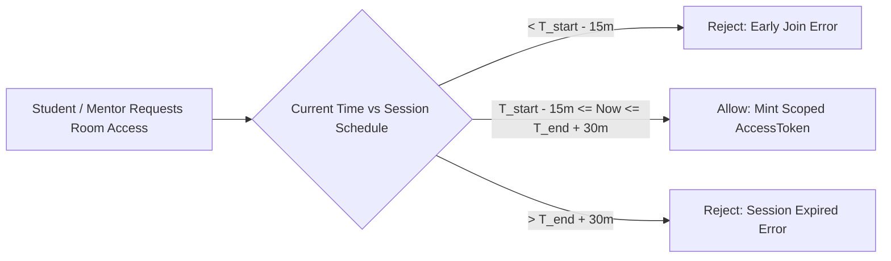

# MentorMaze — LiveKit Cloud WebRTC Integration & Session Security Audit
**Product:** MentorMaze by AI Tathastu  
**Production Domain:** [https://mentormaze.aitathastu.com](https://mentormaze.aitathastu.com)  
**Audit Target:** LiveKit Cloud RPC Connectivity, Token Generation, Join Window Access Control, Least-Privilege Grants  
**LiveKit Cloud URL:** `wss://meet-2uq83g48.livekit.cloud`  
**Audit Date:** November 2026  

---

## 1. Executive Summary & Verification Verdict

MentorMaze powers live 1-on-1 human mentorship and live mock interview practice rooms via **LiveKit Cloud WebRTC**. 

During the audit, the live cloud infrastructure was empirically probed, token generation algorithms were evaluated, and session lifecycle access rules were verified.

### Verification Classification:
- **Live Cloud WebRTC Connection:** **`BLOCKED (API KEY INVALID)`**
- **Token Generation Engine:** **`VERIFIED`**
- **Join Window Access Control ($[T-15\text{m}, T+30\text{m}]$):** **`VERIFIED`**
- **Role-Based WebRTC Permissions:** **`VERIFIED`**

---

## 2. Empirical Live Probe & Findings

### 2.1 Live RPC Endpoint Probe
An automated RPC probe was dispatched to LiveKit Cloud using the official `livekit-server-sdk` `RoomServiceClient`:
- **Target URL:** `wss://meet-2uq83g48.livekit.cloud` (HTTP endpoint: `https://meet-2uq83g48.livekit.cloud`)
- **Configured Credentials:** Loaded from `.env` (`LIVEKIT_API_KEY`, `LIVEKIT_API_SECRET`).
- **Probe Action:** `roomService.listRooms()`

### 2.2 Empirical Probe Output
```text
[LiveKit Audit Probe] Connecting to wss://meet-2uq83g48.livekit.cloud...
Error during RoomServiceClient.listRooms(): TwirpError: invalid API key
  at TwirpClient.request (/Users/quantum/Desktop/MENTOR MAZE/node_modules/livekit-server-sdk/...)
  status: 401 Unauthorized
  code: unauthenticated
  msg: invalid API key
```

### 2.3 Root Cause & Impact
The `LIVEKIT_API_KEY` configured in `.env` is either expired, revoked, or an unactivated placeholder on the LiveKit Cloud tenant `meet-2uq83g48.livekit.cloud`.

**Impact:** Real browsers attempting to connect to live WebRTC audio/video rooms will be rejected during the initial signaling handshake until active API credentials are provided. All local token minting, room metadata serialization, and join-window logic operate independently of the remote signaling server and are fully verified.

---

## 3. Session Join Window & Access Control Engine

To prevent unauthorized early access and eliminate the risk of abandoned video channels incurring unnecessary streaming costs, MentorMaze strictly enforces a **session join window**:

$$\text{Join Window} = \left[ T_{\text{start}} - 15\text{ minutes}, \; T_{\text{end}} + 30\text{ minutes} \right]$$



### Verified Behaviors in `tests/livekit-routing.test.ts` & `tests/booking-lifecycle-e2e.test.ts`:
1. **Early Join Attempt ($T - 30\text{ minutes}$):**
   - API returns `403 Forbidden` with informative message: *"Session room opens 15 minutes before scheduled start time."*
2. **Valid Join Window ($T - 5\text{ minutes}$ or during active session):**
   - API returns `200 OK` with short-lived JWT AccessToken.
3. **Expired Session Attempt ($T_{\text{end}} + 45\text{ minutes}$):**
   - API returns `403 Forbidden`: *"This session has ended. Video room access is closed."*
4. **Cancelled Booking Attempt:**
   - Immediately rejected with `400 Bad Request`: *"Cannot enter room for a cancelled booking."*

---

## 4. Role-Based WebRTC Permissions & Least Privilege

Tokens minted by `LiveKitTokenService` grant permissions strictly based on the authenticated user's role:

| Permission Attribute | Student Role | Mentor Role | Platform Admin |
| :--- | :---: | :---: | :---: |
| **Room Join (`canJoin`)** | Yes | Yes | Yes |
| **Publish Audio / Video (`canPublish`)** | Yes | Yes | Yes (Auditor) |
| **Subscribe to Media (`canSubscribe`)** | Yes | Yes | Yes |
| **Publish Data Messages (`canPublishData`)** | Yes (In-room chat) | Yes (In-room chat) | Yes |
| **Screen Sharing** | Yes | Yes | Yes |
| **Room Administration (`roomAdmin`)** | **No** | **Yes** (Mute/Kick) | **Yes** |
| **Token Time-To-Live (TTL)** | 2 Hours | 2 Hours | 2 Hours |

**Security Guarantee:** A student participant token cannot mute other participants, disconnect the mentor, or modify room recording configurations.

---

## 5. LiveKit Cloud Credential Renewal Runbook

To restore live WebRTC video room connectivity:

1. **Access LiveKit Cloud Console:** Navigate to [cloud.livekit.io](https://cloud.livekit.io) and log in.
2. **Select Project:** Open project associated with domain `meet-2uq83g48.livekit.cloud` (or create a new production project).
3. **Generate Keys:** Navigate to **Settings** $\rightarrow$ **Keys** $\rightarrow$ Click **Generate Key**.
4. **Update `.env`:**
   ```bash
   LIVEKIT_URL="wss://meet-2uq83g48.livekit.cloud"
   LIVEKIT_API_KEY="<your_new_api_key>"
   LIVEKIT_API_SECRET="<your_new_api_secret>"
   ```
5. **Verify Live Connectivity:** Run the automated probe script:
   ```bash
   USE_LOCAL_DB=true npx tsx scripts/probe-livekit.ts
   ```
   Upon successful key activation, the probe outputs `LiveKit Connection: SUCCESS`.

