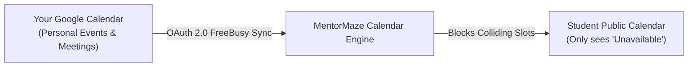

# MentorMaze — Mentor Availability & Schedule Management Guide

**Platform:** [MentorMaze](https://mentormaze.aitathastu.com)  
**Parent Organization:** AI Tathastu  
**Audience:** Approved Tech Mentors & Career Coaches  
**Target URL:** `https://mentormaze.aitathastu.com/mentor/availability`  
**Document Classification:** Operational Guide & Best Practices  

---

## 1. Overview & Availability Philosophy

As a MentorMaze mentor, you have full sovereignty over your calendar. The MentorMaze scheduling system empowers you to set predictable weekly recurring hours, protect your work-life balance with automated buffer times and daily limits, schedule vacation blocks, and link your external Google Calendar so that you never receive bookings when you are busy.

---

## 2. Navigating the Availability Manager

Access your scheduling controls by navigating to:
**Dashboard → Mentor Space → Availability & Calendar** (`/mentor/availability`)

The interface is structured into three specialized tabs:
1. **Weekly Recurring Schedule:** Your standard hours for every day of the week.
2. **Date Exceptions:** Holidays, vacations, or custom one-off hours on specific calendar dates.
3. **Scheduling Rules:** Buffer windows, minimum advance notice, and daily session limits.

---

## 3. Configuring Your Weekly Recurring Schedule

### Enabling / Disabling Days
- Check the box next to any day (Monday through Sunday) to indicate that you are open for bookings.
- Unchecking a day immediately marks it as **Unavailable** for all future weeks.

### Adding Multiple Shifts per Day
Many mentors work in tech companies during daytime hours and offer mentorship during mornings or evenings. MentorMaze supports multiple non-contiguous shift windows on any given day:

1. Tap **Add Shift** on any active day.
2. Configure **Shift 1** (e.g. `10:00 AM` to `1:00 PM`).
3. Configure **Shift 2** (e.g. `6:00 PM` to `9:00 PM`).
4. To remove an extra shift, tap the **Trash icon** next to that window.

> [!TIP]
> **Split Shifts:** Use split shifts if you prefer lunchtime sessions and evening sessions while keeping your core work hours blocked.

---

## 4. Setting Protective Scheduling Rules

Protect yourself from burnout and last-minute surprises by configuring your rules under the **Scheduling Rules** tab:

| Rule Setting | Recommended Value | What It Does |
|---|---|---|
| **Buffer Time Between Sessions** | **15 minutes** | Automatically inserts a break after every completed session before another booking can start. |
| **Minimum Advance Notice** | **2 hours** | Prevents students from booking slots starting within the next $N$ hours, giving you time to prepare. |
| **Maximum Advance Window** | **30 days** | Limits how far into the future students can schedule, avoiding stale commitments months in advance. |
| **Daily Session Limit** | **4 sessions / day** | Caps the maximum number of sessions you will conduct on any single calendar day. |
| **Primary Timezone** | **Asia/Kolkata (IST)** | Sets the base timezone for all your recurring rules. Slots automatically convert to student local time. |

---

## 5. Managing Date Exceptions (Holidays, Vacations & One-Off Days)

When taking time off for holidays, personal travel, or company hackathons, you do **not** need to modify your recurring weekly schedule. Instead, schedule a **Date Exception**:

### How to Block a Vacation or Holiday
1. Open the **Date Exceptions** tab.
2. Under **Add Date Override**, select the specific date from the calendar picker.
3. Leave the type as **Block Whole Day (Unavailable)**.
4. (Optional) Enter a reason (e.g. *"Diwali Festival"*, *"Annual Leave"*).
5. Tap **Add Exception**.
6. The entire day is immediately removed from your public booking calendar.

### Adding Custom One-Off Hours
If you have an open Saturday or holiday and want to offer extra sessions:
1. Select the date and choose **Custom Extra Hours**.
2. Specify the start and end time (e.g. `11:00 AM` to `3:00 PM`).
3. Tap **Add Exception**. Students will only see slots during this custom window.

---

## 6. Pre-Save Conflict Warning System

To safeguard students against unexpected cancellations, MentorMaze includes an automated **Conflict Detection Safety Net**:

### How It Works
If you edit your weekly hours or block a date that **already has confirmed student bookings**, the system intercepts the save request:
1. A modal dialog alerts you: *"Confirmed Booking Conflict Detected"*.
2. It lists each affected session with Student Name, Date, and Time.
3. You have two options:
   - **Cancel & Review:** Keep your existing hours intact until you contact or reschedule with the affected students.
   - **Force Override & Save:** Acknowledge the conflict and proceed with publishing your updated schedule.

---

## 7. Google Calendar Synchronization

Connect your Google Calendar to synchronize your busy periods without sharing any private personal details:

### Privacy Guarantee
MentorMaze queries only Google's `freeBusy` API. Your meeting titles, descriptions, private notes, and attendee lists are **never** imported, stored, or revealed to students. The system only records that you are busy during that interval.

### Linking Your Google Account
1. On the Availability page, locate the **Google Calendar** card in the top right.
2. Tap **Connect Google**.
3. Log in with your Google account and grant calendar read access.
4. You will be redirected back with a green **Connected** badge displaying your email.
5. Tap **Sync Now** anytime to immediately refresh your external busy periods.

