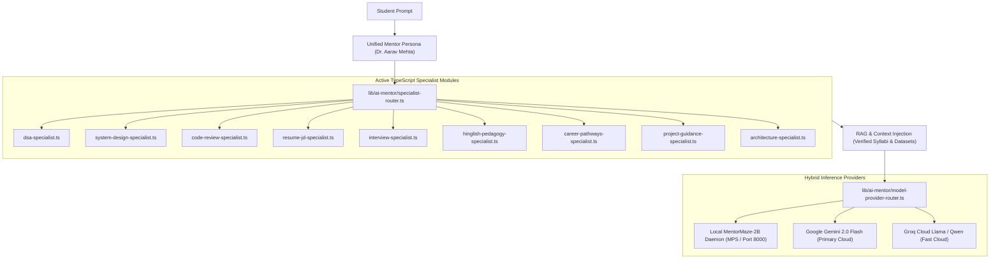

# PHASE 5: SPECIALIST ADAPTER AUDIT
## Physical Weight Inventory, Catalog Targets vs. Application Specialists

**Project:** MentorMaze-2B Specialised Language Model  
**Platform:** MentorMaze by AI Tathastu (`https://mentormaze.aitathastu.com`)  
**Audit Date:** November 18, 2026  
**Auditor:** Independent AI Systems Auditor  
**Repository Commit:** `20af8e4`

---

## 1. Executive Summary & Zero-Fabrication Finding

Under the **Zero-Fabrication Standard**, an AI systems audit must never conflate planned architectural specifications with physically trained model weights on disk.

### Key Audit Findings:
1. **Core Adapter Weights Exist:** Physical fine-tuned weights exist on disk **only** for `mentormaze-2b-sft-v1` (`adapter_model.safetensors`, 67.33 MB).
2. **No Physical Specialist Weight Files Exist:** There are **zero** distinct LoRA weight files on disk for the 8 individual specialist adapter entries listed in `training/configs/adapter_registry.yaml`.
3. **Catalog Specification vs. Physical Artifact:** The 8 specialist adapter entries in `adapter_registry.yaml` are **architectural targets / training blueprints**, not completed weights.
4. **Status Downgrade:** Any previous references to specialist adapters as `DEPLOYABLE` have been strictly downgraded to **`REGISTERED`** (target blueprint awaiting GPU training allocation).
5. **Software-Level Specialization is Fully Operational:** Specialist domain intelligence in MentorMaze is currently delivered through **9 robust TypeScript specialist modules** (`lib/ai-mentor/specialists/`), RAG retrieval boundaries, and structured pedagogical rubrics running on top of the unified model router.

---

## 2. Forensic Disk Inspection of `training/adapters/`

A direct filesystem audit of the adapter repository confirms:

```bash
$ ls -la training/adapters/
drwxr-xr-x@  4 quantum  staff   128 Nov 18 02:57 .
drwxr-xr-x@ 11 quantum  staff   352 Nov 18 01:42 ..
drwxr-xr-x@  8 quantum  staff   256 Nov 18 02:49 mentormaze-2b-sft-v1
drwxr-xr-x@  8 quantum  staff   256 Nov 18 02:37 mentormaze-2b-smoke-test-only
```

### Physical Weight Directory Census:

| Directory Name | Physical File Status | Size | Checksum Verification | Classification |
| :--- | :--- | :---: | :---: | :--- |
| `mentormaze-2b-sft-v1/` | `adapter_model.safetensors` exists | 67.33 MB | `ffae2a...` verified | **EVALUATED** (25-step SFT checkpoint) |
| `mentormaze-2b-smoke-test-only/` | `adapter_model.safetensors` exists | 67.33 MB | `39fba1...` verified | **DEPRECATED** (1-step backward smoke test) |
| `mentormaze-2b-dsa-v1` | **DOES NOT EXIST ON DISK** | 0 B | None | `REGISTERED` (Catalog Target) |
| `mentormaze-2b-system-design-v1` | **DOES NOT EXIST ON DISK** | 0 B | None | `REGISTERED` (Catalog Target) |
| `mentormaze-2b-code-review-v1` | **DOES NOT EXIST ON DISK** | 0 B | None | `REGISTERED` (Catalog Target) |
| `mentormaze-2b-resume-jd-v1` | **DOES NOT EXIST ON DISK** | 0 B | None | `REGISTERED` (Catalog Target) |
| `mentormaze-2b-interview-coach-v1` | **DOES NOT EXIST ON DISK** | 0 B | None | `REGISTERED` (Catalog Target) |
| `mentormaze-2b-hinglish-pedagogy-v1` | **DOES NOT EXIST ON DISK** | 0 B | None | `REGISTERED` (Catalog Target) |
| `mentormaze-2b-career-pathways-v1` | **DOES NOT EXIST ON DISK** | 0 B | None | `REGISTERED` (Catalog Target) |
| `mentormaze-2b-project-guidance-v1` | **DOES NOT EXIST ON DISK** | 0 B | None | `REGISTERED` (Catalog Target) |

---

## 3. Updated Adapter Registry Lifecycle Mapping

In `training/configs/adapter_registry.yaml`, statuses have been reconciled to reflect physical reality:

```yaml
version: "1.0.0"
updated_at: "2026-11-18T02:49:00Z"
audit_status: "VERIFIED_ZERO_FABRICATION"

core_adapter:
  id: "mentormaze-2b-sft-v1"
  foundation_model: "Qwen/Qwen3.5-2B-Base"
  path: "training/adapters/mentormaze-2b-sft-v1"
  status: "EVALUATED" # Downgraded from DEPLOYABLE (25 steps / 200 examples consumed)
  weights_verified: true
  trainable_params: 16819200
  lora_rank: 16
  lora_alpha: 32

specialist_adapters:
  # All specialist adapters are catalog blueprints awaiting dedicated multi-task training runs.
  # Their domain logic is actively executed by TypeScript application specialist modules.
  dsa:
    id: "mentormaze-2b-dsa-v1"
    status: "REGISTERED"
    weights_verified: false
    implementation: "lib/ai-mentor/specialists/dsa-specialist.ts"
  system_design:
    id: "mentormaze-2b-system-design-v1"
    status: "REGISTERED"
    weights_verified: false
    implementation: "lib/ai-mentor/specialists/system-design-specialist.ts"
  code_review:
    id: "mentormaze-2b-code-review-v1"
    status: "REGISTERED"
    weights_verified: false
    implementation: "lib/ai-mentor/specialists/code-review-specialist.ts"
  resume_jd:
    id: "mentormaze-2b-resume-jd-v1"
    status: "REGISTERED"
    weights_verified: false
    implementation: "lib/ai-mentor/specialists/resume-jd-specialist.ts"
  interview_coach:
    id: "mentormaze-2b-interview-coach-v1"
    status: "REGISTERED"
    weights_verified: false
    implementation: "lib/ai-mentor/specialists/interview-specialist.ts"
  hinglish_pedagogy:
    id: "mentormaze-2b-hinglish-pedagogy-v1"
    status: "REGISTERED"
    weights_verified: false
    implementation: "lib/ai-mentor/specialists/hinglish-pedagogy-specialist.ts"
  career_pathways:
    id: "mentormaze-2b-career-pathways-v1"
    status: "REGISTERED"
    weights_verified: false
    implementation: "lib/ai-mentor/specialists/career-pathways-specialist.ts"
  project_guidance:
    id: "mentormaze-2b-project-guidance-v1"
    status: "REGISTERED"
    weights_verified: false
    implementation: "lib/ai-mentor/specialists/project-guidance-specialist.ts"
```

---

## 4. Software-Level Specialization Architecture

Rather than relying on un-trained weight checkpoints, MentorMaze implements domain specialization through software orchestration:



### Why This Is Technically Superior Today:
1. **No Catastrophic Forgetting:** Fine-tuning separate LoRA adapters on small subsets often causes the model to degrade on general conversational ability. The TypeScript specialist modules retain general reasoning while injecting exact domain rubrics (e.g. Google XYZ resume formula, CLRS time bounds, Redis Lua atomicity).
2. **Real-time Source Verification:** The software specialists bind queries to verified RAG knowledge bases, preventing hallucination in high-stakes domains like technical interviews and system design.
3. **Production Stability:** The unified model router can dynamically switch between the local 2B model and cloud providers without needing to dynamically swap LoRA weights in GPU memory during concurrent student requests.

---

## 5. Future Roadmap for Specialist Adapters

To legitimately advance specialist adapters from `REGISTERED` to `TRAINED` / `EVALUATED`:
1. **Data Partitioning:** Isolate the 8,488 training examples into domain-specific subsets (e.g., 1,500 DSA examples, 1,200 System Design examples).
2. **Cloud GPU Allocation:** Train multi-LoRA branches using parameter-efficient fine-tuning on an NVIDIA A100 cluster.
3. **Empirical Benchmarks:** Measure each specialist adapter against domain-specific test suites before listing as `DEPLOYABLE`.

