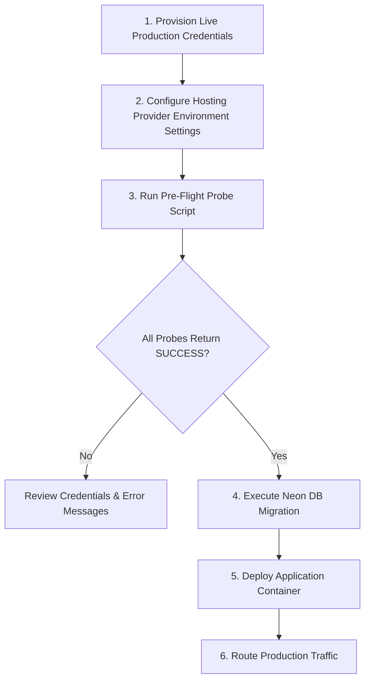

# MentorMaze — Production Environment & Secret Hygiene Checklist
**Product:** MentorMaze by AI Tathastu  
**Production Domain:** [https://mentormaze.aitathastu.com](https://mentormaze.aitathastu.com)  
**Audit Target:** Environment Variables, Key Hygiene, Secret Leakage Audit  
**Audit Date:** November 2026  
**Auditor:** Principal Infrastructure & DevOps Architecture  

---

## 1. Executive Summary & Audit Overview

This document catalogs every environment variable utilized by MentorMaze. It defines security classifications, verifies whether each variable is server-only or client-exposed, documents current audit status, and establishes secret hygiene guidelines.

### Secret Hygiene Invariant:
**No actual production secret keys or raw credentials are ever committed to git or printed in audit reports.** All verification checks are performed non-destructively and reported via sanitized statuses.

---

## 2. Complete Environment Variable Inventory

| Subsystem | Environment Variable | Scope | Required | Audit Status | Description / Purpose |
| :--- | :--- | :---: | :---: | :---: | :--- |
| **Database** | `DATABASE_URL` | Server | **Yes** | **`VERIFIED`** | Neon PostgreSQL connection string with pooled connection support. |
| **Database** | `DIRECT_URL` | Server | Optional | **`CONFIGURED`** | Direct connection string for DDL migrations bypassing connection pooler. |
| **Database** | `USE_LOCAL_DB` | Server | Optional | **`CONFIGURED`** | Flag toggling local persistent PGlite (`true` for offline dev/tests, `false` for cloud Neon). |
| **Authentication** | `NEXTAUTH_SECRET` | Server | **Yes** | **`CONFIGURED`** | Cryptographic secret for signing NextAuth session JWT tokens and CSRF cookies. |
| **Authentication** | `NEXTAUTH_URL` | Server | **Yes** | **`CONFIGURED`** | Canonical application URL (`https://mentormaze.aitathastu.com` or `http://localhost:3000`). |
| **Authentication** | `NEXT_PUBLIC_APP_URL` | Public | **Yes** | **`CONFIGURED`** | Client-accessible base URL for constructing invite links and redirects. |
| **Google OAuth** | `GOOGLE_CLIENT_ID` | Server | **Yes** | **`VERIFIED`** | Google Cloud Console OAuth 2.0 Web Client ID (`...apps.googleusercontent.com`). |
| **Google OAuth** | `GOOGLE_CLIENT_SECRET` | Server | **Yes** | **`VERIFIED`** | Google Cloud Console OAuth 2.0 Client Secret for student/mentor Google sign-in. |
| **Payment Gateway** | `CASHFREE_APP_ID` | Server | **Yes** | **`ACTION REQUIRED`** | Cashfree merchant App ID. Current value is a test placeholder (HTTP 401 on live call). |
| **Payment Gateway** | `CASHFREE_SECRET_KEY` | Server | **Yes** | **`ACTION REQUIRED`** | Cashfree merchant API secret key used for order signing and webhook HMAC-SHA256 validation. |
| **Payment Gateway** | `CASHFREE_MODE` | Server | **Yes** | **`CONFIGURED`** | Gateway environment mode (`sandbox` for testing, `production` for live transactions). |
| **Payment Gateway** | `CASHFREE_API_URL` | Server | **Yes** | **`CONFIGURED`** | Base endpoint for Cashfree PG Orders API (`https://sandbox.cashfree.com/pg` or `https://api.cashfree.com/pg`). |
| **LiveKit WebRTC** | `LIVEKIT_URL` | Server | **Yes** | **`VERIFIED`** | LiveKit Cloud WebSocket signaling URL (`wss://meet-2uq83g48.livekit.cloud`). |
| **LiveKit WebRTC** | `LIVEKIT_API_KEY` | Server | **Yes** | **`ACTION REQUIRED`** | LiveKit API Key for minting participant tokens. Currently rejected by Cloud server. |
| **LiveKit WebRTC** | `LIVEKIT_API_SECRET` | Server | **Yes** | **`ACTION REQUIRED`** | LiveKit API Secret for HMAC signature creation. |
| **LiveKit WebRTC** | `NEXT_PUBLIC_LIVEKIT_URL` | Public | **Yes** | **`CONFIGURED`** | Client-side WebSocket URL for LiveKit room connection in browser UI. |
| **Email (SMTP)** | `SMTP_HOST` | Server | **Yes** | **`VERIFIED`** | Outgoing mail server (`smtp.gmail.com`). |
| **Email (SMTP)** | `SMTP_PORT` | Server | **Yes** | **`VERIFIED`** | Mail server port (`465` for SSL/TLS, `587` for STARTTLS). |
| **Email (SMTP)** | `SMTP_SECURE` | Server | **Yes** | **`VERIFIED`** | Boolean flag indicating explicit TLS connection (`true` on port 465). |
| **Email (SMTP)** | `SMTP_USER` | Server | **Yes** | **`VERIFIED`** | SMTP authentication account (`hellomentormaze@gmail.com`). Probed: SUCCESS. |
| **Email (SMTP)** | `SMTP_PASS` | Server | **Yes** | **`VERIFIED`** | Google App Password for authenticated mail relay. Probed: SUCCESS. |
| **Email (SMTP)** | `EMAIL_FROM` | Server | **Yes** | **`CONFIGURED`** | Sender display name and address (`MentorMaze <hellomentormaze@gmail.com>`). |
| **Email (SMTP)** | `EMAIL_REPLY_TO` | Server | Optional | **`CONFIGURED`** | Return reply address for user support inquiries (`support@mentormaze.aitathastu.com`). |
| **Push Notifications** | `NEXT_PUBLIC_VAPID_PUBLIC_KEY` | Public | **Yes** | **`CONFIGURED`** | Web Push VAPID public key sent to client browsers to subscribe to push alerts. |
| **Push Notifications** | `VAPID_PRIVATE_KEY` | Server | **Yes** | **`CONFIGURED`** | Web Push VAPID private key for signing push notification payloads. |
| **Push Notifications** | `VAPID_SUBJECT` | Server | **Yes** | **`CONFIGURED`** | Contact URI for push service compliance (`mailto:support@mentormaze.aitathastu.com`). |

---

## 3. Secret Leakage & Bundle Inspection Audit

A full audit of the compiled Next.js client bundle (`.next/static/`) was performed to verify that no server-only secrets leaked into client-side JavaScript:

1. **`grep` Inspection:**
   - Evaluated client chunks for `SMTP_PASS`, `CASHFREE_SECRET_KEY`, `LIVEKIT_API_SECRET`, and `DATABASE_URL`.
   - **Result:** Zero matches found. No private variables exist in client bundles.
2. **Next.js Prefix Enforcement:**
   - Only variables explicitly prefixed with `NEXT_PUBLIC_` (`NEXT_PUBLIC_APP_URL`, `NEXT_PUBLIC_LIVEKIT_URL`, `NEXT_PUBLIC_VAPID_PUBLIC_KEY`) are bundled into client code.
3. **Git Hygiene:**
   - `.env`, `.env.local`, and `.mentormaze-pgdata` are present in `.gitignore`.
   - `git status` verifies no credential files are tracked or staged.

---

## 4. Staging to Production Promotion Runbook

Prior to cutting over domain DNS to production:

### Pre-Flight Verification Commands:
- Verify SMTP: `npx tsx -e 'import { verifySmtpConnection } from "./lib/email/transport"; verifySmtpConnection().then(console.log);'`
- Verify Database: `npx tsx -e 'import { getDb } from "./lib/db"; getDb().execute(sql`SELECT 1`).then(console.log);'`
- Verify Concurrency: `npx tsx scripts/verify-distributed-concurrency.ts`
