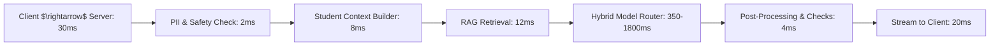

# MENTORMAZE — RELIABILITY SPECIFICATION & SERVICE LEVEL OBJECTIVES (SLO)
## Latency Targets, Availability Budgets, Hallucination Thresholds & Observability

**Product:** MentorMaze by AI Tathastu  
**Production Domain:** `https://mentormaze.aitathastu.com`  
**Observability Route:** `/admin/ai-mentor`  

---

## 1. Service Level Objectives (SLOs)

MentorMaze measures AI Mentor reliability against four non-negotiable operational SLOs:

| SLO Dimension | Target Objective | Measurement Window | Action on Breach |
| :--- | :--- | :--- | :--- |
| **Availability** | $\ge 99.9\%$ uptime | Rolling 30 days | Immediate fallback to deterministic pedagogical core |
| **P50 Latency** | $< 800\text{ms}$ | Rolling 24 hours | Rebalance to fast-tier Groq/Gemini Flash |
| **P95 Latency** | $< 3,500\text{ms}$ | Rolling 24 hours | Engage streaming chunking; alert on slow API |
| **Socratic Compliance** | $\ge 95.0\%$ | Weekly benchmark | Rollback to evaluated checkpoint / enforce Socratic prompt |
| **Zero-Hallucination (Resume)**| $100.0\%$ | Continuous audit | Intercept and strip unverified metric claims |

---

## 2. Latency Budget & Asymptotic Breakdown

### Typical Latency Budgets
- **Deterministic Core Turn:** $0.4\text{ms} - 5\text{ms}$ (instantaneous).
- **On-Device 2B Turn:** $600\text{ms} - 1,200\text{ms}$ (Apple Silicon MPS / MLX).
- **Cloud LLM Turn (Gemini Flash / Groq):** $1,200\text{ms} - 3,200\text{ms}$ (streaming begins within $250\text{ms}$).

---

## 3. Observability & Telemetry Architecture

Every turn records high-cardinality metadata in the central telemetry ledger:
- `requestId`: Unique turn UUID.
- `timestamp`: UTC ISO timestamp.
- `latencyMs`: Precise round-trip timing from performance.now().
- `tokenUsage`: Exact prompt, completion, and total tokens.
- `estimatedCostUsd`: Per-turn cost computed from provider tariff tables.
- `modelProvider`: Active model identifier.
- `inferenceMode`: Generative, deterministic, or fine-tuned-2b.
- `fallbackReason`: Root cause if fallback was triggered.

Telemetry analytics are accessible live via `/api/admin/ai-mentor` and displayed across the 8 tabs of `/admin/ai-mentor`.
