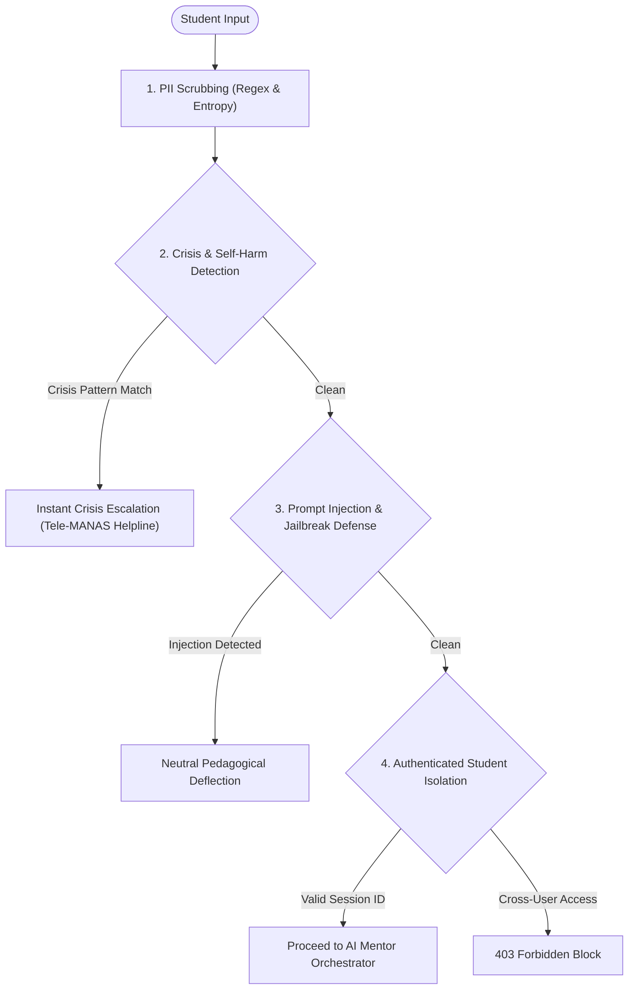

# MENTORMAZE — AI MENTOR SECURITY ARCHITECTURE
## Crisis Guardrails, PII Sanitization, Multi-Tenant Isolation & Clinical Boundaries

**Product:** MentorMaze by AI Tathastu  
**Production Domain:** `https://mentormaze.aitathastu.com`  
**Security Controller:** `SafetyGuardrails` (`lib/ai-mentor/safety-guardrails.ts`)

---

## 1. Architectural Security Perimeter

The MentorMaze AI Mentor operates strictly within technical education and career engineering boundaries. Under no circumstances does the system provide clinical diagnosis, mental health therapy, financial advice, or bypass institutional honor codes.

---

## 2. Multi-Layer Guardrails

### 2.1 Crisis Boundaries & Emergency Escalation
MentorMaze strictly monitors incoming prompts for self-harm, emotional crisis, and despair signals.
- **Pattern Matching:** Detection of phrases indicating imminent harm, extreme hopelessness, or clinical depression.
- **Immediate Response:** Bypasses LLM generation entirely. Emits a deterministic, empathetic crisis notice providing verified Indian emergency helplines:
  - **Tele-MANAS:** `14416` / `1800-891-4416` (24/7 Government of India National Mental Health Helpline)
  - **AASRA Helpline:** `+91-9820466726`
- **Session Preservation:** The safety response is safely recorded in the student's conversation store without punitive flagging.

### 2.2 PII Scrubbing & Data Protection
Before any message is passed to external LLM providers or local vector databases:
- **Phone Numbers:** Indian 10-digit mobile numbers (`+91`, `9xxxx`, `8xxxx`, `7xxxx`, `6xxxx`) are scrubbed and replaced with `[PHONE_REDACTED]`.
- **Email Addresses:** Standard RFC 5322 email patterns are scrubbed and replaced with `[EMAIL_REDACTED]`.
- **Aadhaar / National IDs:** 12-digit numeric sequences are scrubbed and replaced with `[GOVT_ID_REDACTED]`.
- **Institutional Roll Numbers:** College registration numbers are anonymized.

### 2.3 Prompt Injection & Jailbreak Defense
- System instructions are strictly isolated in system message blocks and cannot be overridden by user message formatting (`Ignore previous instructions`, `DAN mode`, `Developer Mode`).
- System personas enforce immutable brand loyalty to MentorMaze by AI Tathastu.
- Zero credential disclosure: System prompts, database connection strings, and API keys are strictly excluded from runtime model contexts.

### 2.4 Multi-Tenant Student Data Isolation
- **Direct Object Reference (IDOR) Protection:** Endpoints verifying student conversations (`/api/ai-mentor/conversations/[id]`) and memories (`/api/ai-mentor/memory`) enforce cryptographically verified session cookies.
- A student cannot query, view, modify, or delete another student's conversations, memories, or skill graph entries. Attempted cross-tenant access returns an immediate HTTP 403 Forbidden.
