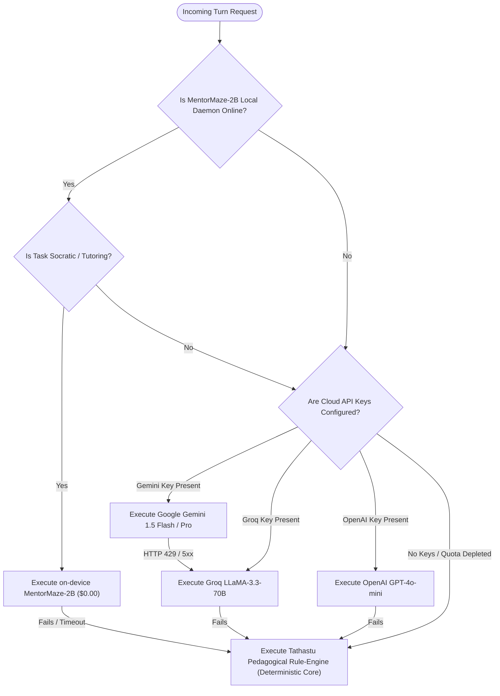

# MENTORMAZE — HYBRID LLM ROUTING POLICY
## Workload Partitioning, Provider Arbitration & Fallback Governance

**Product:** MentorMaze by AI Tathastu  
**Production Domain:** `https://mentormaze.aitathastu.com`  
**Host Controller:** `ModelProviderRouter` (`lib/ai-mentor/model-provider-router.ts`)

---

## 1. Architectural Philosophy

MentorMaze operates on a **cost-disciplined, reliability-first hybrid routing model**. We reject two extremes:
1. *Sole reliance on cloud APIs:* Leads to unpredictable latency, recurring API costs, vendor lock-in, and downtime during outages.
2. *Sole reliance on local SLMs:* 2B models lack the massive knowledge surface area required for complex multi-tier system designs or obscure syntax debugging.

The Hybrid Router balances:
- **On-Device Core (`MentorMaze-2B`):** Fast, zero marginal cost ($0.00/token), high privacy for conceptual tutoring and Socratic progressive hints.
- **External Frontier APIs (Google Gemini, Groq, OpenAI, Anthropic):** High-capacity generative inference for deep code refactoring, complex multi-system trade-off analyses, and nuanced mock interviews.
- **Deterministic Rule Engine (Tathastu Pedagogy Core):** Sub-millisecond latency (0.4ms), 100% availability, zero hallucination fallback for offline scenarios or API rate-limit saturation.

---

## 2. Workload Partitioning Matrix

The router classifies incoming turns by `taskCategory` and `FocusArea`:

| Task Category | Focus Area | Primary Target | Fallback Target | Latency Target | Estimated Cost / 1k Turns |
| :--- | :--- | :--- | :--- | :--- | :--- |
| **Socratic Tutoring** | `learn`, `practice` | `MentorMaze-2B` / Gemini Flash | Tathastu Pedagogy v1 | < 800ms | $0.00 – $0.15 |
| **Algorithmic Review** | `coding_dsa` | Gemini 1.5 Pro / Groq LLaMA-70B | CodeMentor Sandbox | < 2500ms | $0.80 – $2.50 |
| **System Architecture**| `system_design` | Gemini 1.5 Flash / Groq | Tathastu Architecture Core | < 1800ms | $0.30 – $0.90 |
| **Career & Placement** | `career` | CareerIntelligence Core | Gemini 1.5 Flash | < 500ms | $0.00 – $0.20 |
| **Resume Rewriting** | `resume` | CareerIntelligence (Google XYZ) | Gemini 1.5 Flash | < 400ms | $0.00 – $0.20 |
| **Mock Interview** | `interview` | Gemini 1.5 Pro / Groq | InterviewCoach Rubric Engine | < 2000ms | $0.60 – $1.80 |
| **Study Roadmapping** | `study_planning` | CareerIntelligence Dynamic | Gemini 1.5 Flash | < 300ms | $0.00 – $0.10 |

---

## 3. Provider Arbitration Algorithm

### Fallback Triggers
An automatic fallback to the deterministic pedagogical engine is triggered if:
1. **Network Timeout:** External provider request exceeds 12,000ms.
2. **Rate Limit (HTTP 429):** API quota exhausted or burst throttled.
3. **Authentication Failure (HTTP 401/403):** Expired or malformed provider credentials.
4. **Local Daemon Offline:** `http://127.0.0.1:8000` is unreachable (Connection Refused).

---

## 4. Telemetry & Cost Governance

Every turn processed through `ModelProviderRouter` records:
- `requestId`: Unique trace identifier.
- `modelProvider`: e.g. `groq/qwen/qwen3.8-27b`, `gemini/gemini-1.5-flash`, or `tathastu-pedagogy-v1`.
- `latencyMs`: Elapsed round-trip time.
- `tokenUsage`: Exact input, completion, and total tokens.
- `estimatedCostUsd`: Computed against live provider pricing schedules.
- `fallbackReason`: Explicitly logged if fallback was engaged.

*Zero secret leakage:* All API keys are masked (`AIzaSy...4aA`) in telemetry logs and admin dashboards.
