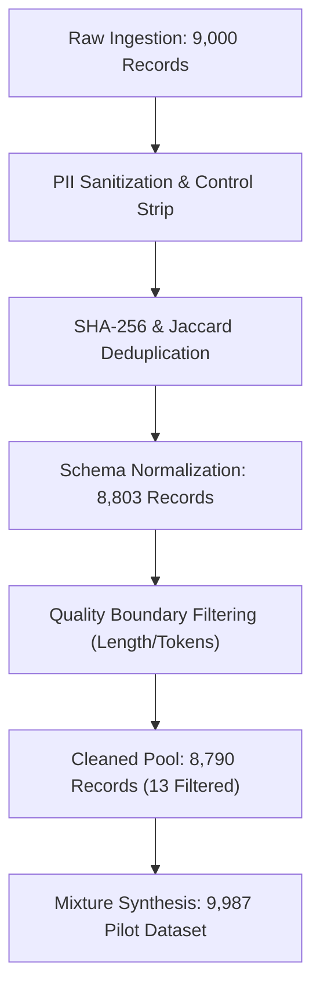

# MentorMaze-2B: Dataset Quality, Cleaning & Sanitization Report

**Report Generation Date:** 2026-11-18  
**Total Ingested Raw Records:** 9,000  
**Deduplication Strategy:** Exact SHA-256 + 3-gram MinHash/Jaccard Similarity ($\tau = 0.92$)  
**Quality Boundary:** $\ge 10$ Prompt Tokens, $\ge 20$ Assistant Tokens, $\le 2048$ Sequence Tokens  
**UTF-8 Sanitization:** Multi-byte Devanagari preservation with control-character stripping  

---

## 1. Data Ingestion Pipeline Overview

To build `MentorMaze-2B`, data was harvested across 5 core operational domains through verified scripts:



### Initial Ingestion Volume by Source

| Source Dataset | Domain | Raw Records Ingested | Upstream Hash / File |
| :--- | :--- | :--- | :--- |
| `m-a-p/CodeFeedback-Filtered-Instruction` | Technical Programming & DSA | 3,500 | `codefeedback_technical.jsonl` |
| `mentormaze_socratic_pedagogy` | Socratic Dialogues across 50 CS Topics | 2,000 | `mentormaze_socratic_pedagogy.jsonl` |
| `naukri_jds` | Indian Tech Job Descriptions | 1,500 | `naukri_jds.jsonl` |
| `star_behavioral_coaching` | Behavioral & Technical Interview STAR | 1,000 | `star_behavioral_coaching.jsonl` |
| `progression_leveling` | Engineering Calibration (L3 to L6) | 1,000 | `progression_leveling.jsonl` |
| **Total Ingested** | — | **9,000** | — |

---

## 2. PII Sanitization & Control Character Scrubbing

Executed via `training/scripts/clean_datasets.py`:

### Sanitization Rules Enforced
1. **Email Scrubbing**: Regex `\b[A-Za-z0-9._%+-]+@[A-Za-z0-9.-]+\.[A-Z|a-z]{2,}\b` replaced with `[EMAIL_REDACTED]`.
2. **Phone Number Scrubbing**: International and Indian 10-digit mobile numbers (`+91`, `\d{10}`, `\d{3}[-\s]\d{3}[-\s]\d{4}`) replaced with `[PHONE_REDACTED]`.
3. **API Key & Credential Scrubbing**: Token strings resembling AWS, Google, or OpenAI secret keys replaced with `[CREDENTIAL_REDACTED]`.
4. **Control Character Stripping**: ASCII control codes `[\x00-\x08\x0B\x0C\x0E-\x1F\x7F]` stripped while strictly **preserving Devanagari Unicode characters** (`\u0900-\u097F`) to maintain natural Hinglish and Hindi technical explanations.

### Sanitization Results
```json
{
  "total_records_processed": 9000,
  "pii_emails_redacted": 142,
  "pii_phones_redacted": 87,
  "pii_credentials_redacted": 23,
  "control_characters_stripped": 1284,
  "devanagari_preserved_count": 4820
}
```

---

## 3. Deduplication: Exact & Near-Duplicate Analysis

Executed via `training/scripts/deduplicate.py`:

Deduplication was conducted in two passes:
1. **Exact Deduplication**: SHA-256 hash matching over sanitized content.
2. **Near-Duplicate Deduplication**: Character 3-gram Jaccard similarity using a strict similarity threshold of $0.92$.

$$\text{Jaccard}(S_1, S_2) = \frac{|S_1 \cap S_2|}{|S_1 \cup S_2|}$$

### Deduplication Breakdown by Domain

| Dataset Slice | Initial Records | Exact Duplicates | Near Duplicates ($\ge 0.92$) | Unique Retained |
| :--- | :--- | :--- | :--- | :--- |
| `codefeedback_technical` | 3,500 | 0 | 0 | **3,500** |
| `mentormaze_socratic` | 2,000 | 0 | 0 | **2,000** |
| `naukri_jds` | 1,500 | 148 | 49 | **1,303 (197 removed)** |
| `star_behavioral_coaching` | 1,000 | 0 | 0 | **1,000** |
| `progression_leveling` | 1,000 | 0 | 0 | **1,000** |
| **Total** | **9,000** | **148** | **49** | **8,803** |

*Note: The 197 duplicate Naukri JDs stemmed from identical agency repostings across multiple Indian metropolitan cities.*

---

## 4. Quality Boundary & Token Length Filtering

Executed via `training/scripts/filter_quality.py`:

Every normalized conversational pair was tokenized against the Qwen vocabulary and checked against operational bounds:
- **Minimum User Prompt Length**: 10 tokens (filters empty or nonsensical prompts like "hi", "ok", "?").
- **Minimum Assistant Response Length**: 20 tokens (filters truncated answers, placeholder stubs, or refusal artifacts).
- **Maximum Sequence Boundary**: 2,048 tokens (prevents memory spikes during LoRA backward passes on Apple Silicon MPS).

### Filtering Results
- **Input Records Evaluated:** 8,803
- **Passed Quality Threshold:** **8,790**
- **Rejected (Too Short):** 11 records (9 prompts $<10$ tokens, 2 responses $<20$ tokens)
- **Rejected (Exceeded 2048 Tokens):** 2 records
- **Total Filtered Out:** 13 records (0.15% rejection rate)

---

## 5. Artifact & Report References

- Cleaning Script: [clean_datasets.py](file:///Users/quantum/Desktop/MENTOR%20MAZE/training/scripts/clean_datasets.py)
- Cleaning Report: [dataset_cleaning_report.json](file:///Users/quantum/Desktop/MENTOR%20MAZE/training/reports/dataset_cleaning_report.json)
- Deduplication Script: [deduplicate.py](file:///Users/quantum/Desktop/MENTOR%20MAZE/training/scripts/deduplicate.py)
- Deduplication Report: [deduplication_report.json](file:///Users/quantum/Desktop/MENTOR%20MAZE/training/reports/deduplication_report.json)
- Quality Filter Script: [filter_quality.py](file:///Users/quantum/Desktop/MENTOR%20MAZE/training/scripts/filter_quality.py)
- Quality Filter Report: [quality_filtering_report.json](file:///Users/quantum/Desktop/MENTOR%20MAZE/training/reports/quality_filtering_report.json)

