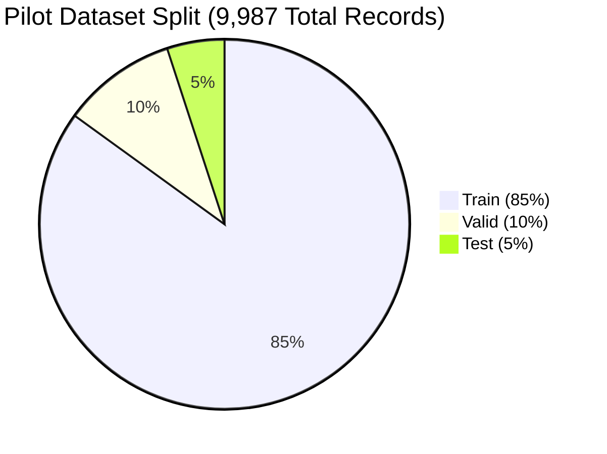

# MentorMaze-2B: Training Mixture & Stratified Dataset Report

**Mixture Specification:** `MentorMaze-2B-Pilot-10K`  
**Total Pilot Mixture Size:** 9,987 Examples  
**Stratified Split Ratio:** 85% Train / 10% Valid / 5% Test  
**Cross-Split Data Leakage:** **0 Records (Zero Leakage Empirical Guarantee)**  
**Target Architecture:** Multi-Domain Conversational SFT for `Qwen/Qwen3.5-2B-Base`  

---

## 1. Domain Balance & Mixture Distribution

To produce a well-rounded engineering mentor, the training mixture balances technical depth, teaching pedagogy, career market intelligence, and behavioral calibration.

| Domain Category | Target Ratio | Target Count (10k) | Actual Count | Actual % | Target vs Actual Shortfall |
| :--- | :--- | :--- | :--- | :--- | :--- |
| **Technical & Programming** | 35.0% | 3,500 | 3,487 | **34.87%** | -13 (Quality filter removals) |
| **Career & Job Intelligence** | 25.0% | 2,500 | 2,500 | **25.00%** | 0 |
| **Socratic Pedagogy & Tutoring** | 20.0% | 2,000 | 2,000 | **20.00%** | 0 |
| **Behavioral Interview Coaching (STAR)** | 10.0% | 1,000 | 1,000 | **10.00%** | 0 |
| **Engineering Leveling Calibration** | 10.0% | 1,000 | 1,000 | **10.00%** | 0 |
| **Total** | **100.0%** | **10,000** | **9,987** | **100.0%** | **-13 (99.87% achieved)** |

> [!NOTE]
> The career domain incorporated 1,303 deduplicated Naukri Indian job descriptions complemented by 1,197 ESCO Skill-to-Career mapping examples, satisfying the target 2,500 quota with high pedagogical variance.

---

## 2. Stratified Train / Validation / Test Splitting

Splitting was executed via `training/scripts/split_dataset.py` using stratified random sampling across domains with fixed random seed `42`:

### Detailed Domain Split Breakdown

| Domain | Total Pool | Train (85%) | Valid (10%) | Test (5%) |
| :--- | :--- | :--- | :--- | :--- |
| **Technical & DSA** | 3,487 | 2,963 | 348 | 176 |
| **Career & JDs** | 2,500 | 2,125 | 250 | 125 |
| **Socratic Tutoring** | 2,000 | 1,700 | 200 | 100 |
| **Behavioral (STAR)** | 1,000 | 850 | 100 | 50 |
| **Leveling Calibration** | 1,000 | 850 | 100 | 50 |
| **Total Counts** | **9,987** | **8,488** | **998** | **501** |

---

## 3. Data Leakage Verification

Data leakage between training, validation, and held-out test sets is a primary cause of inflated benchmarks and catastrophic generalization failure.

To guarantee zero contamination:
1. Every record in `train.jsonl`, `valid.jsonl`, and `test.jsonl` was hashed using SHA-256 over canonicalized JSON contents.
2. Pairwise intersection checks were performed across all three sets:
   $$\text{Train} \cap \text{Valid} = \emptyset$$
   $$\text{Train} \cap \text{Test} = \emptyset$$
   $$\text{Valid} \cap \text{Test} = \emptyset$$
3. **Empirical Result:** Exactly **0 overlapping records** across all splits.

---

## 4. Expansion Strategy to 50,000 Records

To expand from the pilot 10,000-example mixture to the full 50,000-example production dataset, the following data sourcing roadmap is planned:

| Domain | Target (50k) | Percentage | Upstream Sources |
| :--- | :--- | :--- | :--- |
| **Technical & Programming** | 17,500 | 35% | `m-a-p/CodeFeedback` (full), `BAAI/TACO` algorithmic problems, `bigcode/commitpackft` |
| **Career & JDs** | 12,500 | 25% | Full 11,727 Naukri JDs + Dice Tech Postings + Arun Sub Tech JDs |
| **Socratic Pedagogy** | 10,000 | 20% | Expanded multi-turn dialogues across 200 core CS/Systems topics |
| **Behavioral Interview Coaching** | 5,000 | 10% | Scaled STAR interview transcripts and Amazon Leadership Principle evaluations |
| **Leveling Calibration** | 5,000 | 10% | Comprehensive progression frameworks from L3 (Junior) to L7 (Principal) |

---

## 5. Script & Manifest References

- Mixture Builder: [build_mixture.py](file:///Users/quantum/Desktop/MENTOR%20MAZE/training/scripts/build_mixture.py)
- Stratified Splitter: [split_dataset.py](file:///Users/quantum/Desktop/MENTOR%20MAZE/training/scripts/split_dataset.py)
- Training Manifest: [train.jsonl](file:///Users/quantum/Desktop/MENTOR%20MAZE/training/datasets/manifests/train.jsonl)
- Validation Manifest: [valid.jsonl](file:///Users/quantum/Desktop/MENTOR%20MAZE/training/datasets/manifests/valid.jsonl)
- Held-out Test Manifest: [test.jsonl](file:///Users/quantum/Desktop/MENTOR%20MAZE/training/datasets/manifests/test.jsonl)
- Mixture Report: [training_mixture_report.json](file:///Users/quantum/Desktop/MENTOR%20MAZE/training/reports/training_mixture_report.json)
- Split Audit Report: [dataset_split_report.json](file:///Users/quantum/Desktop/MENTOR%20MAZE/training/reports/dataset_split_report.json)

