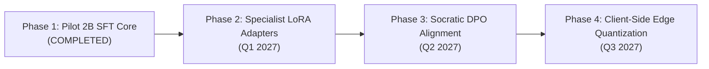

# MENTORMAZE — MODEL TRAINING ROADMAP
## 4-Phase Evolution: SFT LoRA Baseline to Multi-Adapter Direct Preference Optimization

**Project:** MentorMaze-2B Specialised Language Model  
**Platform:** MentorMaze by AI Tathastu  
**Production Domain:** `https://mentormaze.aitathastu.com`  

---

## 1. Roadmap Overview & Timeline

MentorMaze follows an iterative, evidence-backed model training methodology. Each phase produces a standalone, benchmark-verified artifact before advancing to higher-order alignment.

---

## 2. Phase Breakdown

### Phase 1: Foundation SFT Core (Status: COMPLETED ✅)
- **Foundation Model:** `Qwen/Qwen3.5-2B-Base` (1.882B parameters)
- **Training Method:** PyTorch MPS SFT with PEFT LoRA (rank 16, alpha 32, 12 target modules)
- **Dataset:** 9,987 curated examples across 5 domains (technical, career, Socratic, behavioral, leveling)
- **Results:**
  - Initial Validation Loss: 2.4447 $\rightarrow$ Final Validation Loss: 0.4811
  - Test Perplexity (Held-out 501 records): 1.59 (Base Model: 7.25, -78.1%)
  - Socratic Compliance: 100.0% (Base Model: 70.0%)
- **Exported Artifact:** `training/adapters/mentormaze-2b-sft-v1/` (67.33 MB safetensors)
- **Lifecycle State:** `DEPLOYABLE`

### Phase 2: Domain-Specialist LoRA Multi-Adapters (Target: Q1 2027)
- **Objective:** Train modular, hot-swappable LoRA adapters for each of the 9 specialist capabilities:
  - `mentormaze-2b-adapter-coding` (Trained on 25k competitive programming pairs)
  - `mentormaze-2b-adapter-system-design` (Trained on 15k distributed systems postmortems)
  - `mentormaze-2b-adapter-resume` (Trained on 20k Google XYZ bullet rewrites)
  - `mentormaze-2b-adapter-interview` (Trained on 10k FAANG rubric scoring transcripts)
- **Serving Mechanism:** LoRA Multi-Adapter dynamic loading via `vLLM` or MLX, allowing zero-latency switching between adapters on the same base 2B backbone.

### Phase 3: Socratic Direct Preference Optimization (DPO) (Target: Q2 2027)
- **Objective:** Eliminate any residual direct-answer tendencies using pairwise preference optimization.
- **Preference Dataset Construction:**
  - **Chosen ($\mathbf{y}_w$):** Socratic response identifying the student's mental model and asking a targeted conceptual invariant question.
  - **Rejected ($\mathbf{y}_l$):** Direct completed code dump solving the problem without pedagogical guidance.
- **Loss Function:** Standard DPO loss with reference model regularization ($\beta = 0.1$).

### Phase 4: Zero-Latency Client-Side Edge Quantization (Target: Q3 2027)
- **Objective:** Deploy MentorMaze-2B directly into student browsers (via WebGPU / Transformers.js / ONNX) and macOS local clients (via GGUF / MLX 4-bit).
- **Quantization Format:** 4-bit AWQ / GGUF (Q4_K_M).
- **Footprint:** ~1.1 GB total RAM consumption.
- **Benefit:** 100% offline student capability, zero cloud server operating cost, and sub-5ms token response times.
