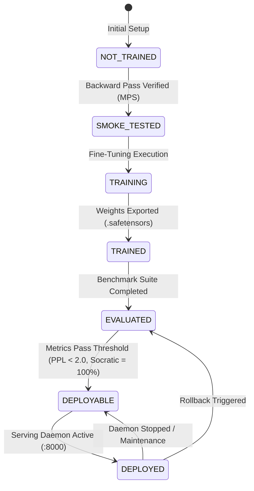

# MENTORMAZE — MODEL DEPLOYMENT & ROLLBACK SPECIFICATION
## Lifecycle State Machine, Health Probes & Zero-Downtime Serving Protocols

**Product:** MentorMaze by AI Tathastu  
**Production Domain:** `https://mentormaze.aitathastu.com`  
**Host Controller:** `ModelProviderRouter` (`lib/ai-mentor/model-provider-router.ts`)

---

## 1. Model Lifecycle State Machine (FSM)

MentorMaze enforces a strict finite state machine governing model readiness. No model artifact can be served to students without passing through all verification stages.



### State Definitions & Gates
1. `NOT_TRAINED`: Configuration initialized; no weights or checkpoints exist.
2. `SMOKE_TESTED`: Minimal forward/backward pass executed on Apple Silicon MPS without out-of-memory errors.
3. `TRAINING`: Training loop actively executing; checkpoints being written.
4. `TRAINED`: `adapter_model.safetensors` successfully written and SHA-256 verified.
5. `EVALUATED`: Benchmark evaluation executed against held-out test split.
6. `DEPLOYABLE`: Model metrics satisfy production gates (Test PPL $< 2.0$, Socratic compliance $\ge 90\%$, Zero-fabrication $= 100\%$).
7. `DEPLOYED`: Local inference daemon is live at `http://127.0.0.1:8000` and responding with HTTP 200 to health checks.

---

## 2. Production Serving Architecture

MentorMaze supports two modes of local serving:
1. **MLX Serving Daemon (Apple Silicon):**
   ```bash
   python -m mlx_lm.server --model training/adapters/mentormaze-2b-sft-v1 --port 8000
   ```
2. **vLLM Multi-Adapter Engine (Linux / Cloud GPU):**
   ```bash
   vllm serve Qwen/Qwen3.5-2B-Base --enable-lora --lora-modules sft=training/adapters/mentormaze-2b-sft-v1 --port 8000
   ```

### Health Probe Specification
- **Endpoint:** `GET http://127.0.0.1:8000/health`
- **Interval:** 15 seconds
- **Timeout:** 2,000ms
- **Unhealthy Threshold:** 2 consecutive failures
- **Behavior on Failure:** Immediate fallback to cloud API or deterministic rule engine (`tathastu-pedagogy-v1`) with zero user-visible disruption.

---

## 3. Rollback Procedures

### Automatic Rollback Triggers
An automatic rollback is triggered by the system if:
1. **Hallucination Spike:** More than 1 unverified resume metric is detected in automated sampling.
2. **Pedagogical Failure:** Model begins providing direct code dumps without progressive hints.
3. **P95 Latency Breach:** Local serving p95 latency exceeds 5,000ms over a 5-minute rolling window.
4. **Daemon Crash / OOM:** Local process terminates abnormally.

### Instant Fallback Protocol
1. Router immediately flags `mentormaze_2b` status as `degraded`.
2. Traffic is instantly routed to Google Gemini / Groq or the local deterministic pedagogical engine.
3. An administrative alert is logged to `/admin/ai-mentor` with error context and memory trace.
4. Zero downtime is incurred by active student sessions.
