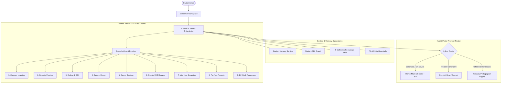

# MENTORMAZE — UNIFIED INTELLIGENCE ARCHITECTURE
## One Mentor. Multiple Specialist Capabilities. Fine-Tuned Models. Hybrid LLM Intelligence.

**Product:** MentorMaze by AI Tathastu  
**Production Domain:** `https://mentormaze.aitathastu.com`  
**Primary Student Interface:** `/ai-mentor`  
**Admin Control Center:** `/admin/ai-mentor`  
**Sole Unified Mentor:** Dr. Aarav Mehta (Principal Mentor · AI Intelligence)  
**Primary Local Model Project:** MentorMaze-2B (`Qwen/Qwen3.5-2B-Base`)

---

## 1. Executive Summary & Product Vision

MentorMaze rejects the fragmented paradigm of deploying eight disconnected chatbots with separate avatars, fragmented personas, and siloed memory databases. Students do not want to switch between eight different artificial personas to learn algorithms, review code, architect distributed systems, improve resumes, and prepare for interviews.

Instead, MentorMaze establishes a **Unified Intelligence Architecture**:
- **One Singular Mentor:** The student interacts continuously with **Dr. Aarav Mehta**, Principal Mentor at MentorMaze by AI Tathastu.
- **Nine Internal Specialist Capabilities:** Rather than changing mentors, Dr. Aarav Mehta dynamically activates specialized internal reasoning and analysis modules based on explicit user intent or natural language prompt classification.
- **Unbroken Context & Memory Continuity:** The student's conversation thread, authenticated profile, mastery states, recent mistakes, and persistent memory remain completely unified across all queries.
- **Hybrid Inference Foundation:** Seamlessly unifies on-device fine-tuned models (`MentorMaze-2B` with domain LoRA adapters) with external frontier APIs (Gemini 1.5 Flash/Pro, Groq LLaMA-3.3-70B) and deterministic zero-hallucination fallback engines.

---

## 2. Core System Components

### 2.1 The Unified Mentor Persona
- **Full Identity:** Dr. Aarav Mehta
- **Role & Credentials:** Principal Mentor · Staff Software Architect & Placement Strategist (MentorMaze by AI Tathastu)
- **Voice & Pedagogy:** Empathetic, rigorous, evidence-driven, and structurally focused on first-principles understanding.
- **Persistent Tone:** Does not break character. Whether guiding a student through 0/1 Knapsack recurrence or reviewing an SDE-1 resume, Dr. Aarav Mehta maintains consistent standards of clarity and intellectual honesty.

### 2.2 Nine Internal Specialist Capabilities
1. **Concept Learning Specialist (`learn`):** Deconstructs core computer science principles with verified invariants, operational trade-offs, and mental models.
2. **Socratic Practice Specialist (`practice`):** Delivers 3-tier progressive hints (Level 1: Invariant question $\rightarrow$ Level 2: Recurrence/pointer state $\rightarrow$ Level 3: Boundary pseudo-code) preventing premature code leaks.
3. **Coding & DSA Specialist (`coding_dsa`):** Line-by-line review, asymptotic proofs ($O(N)$ vs $O(N^2)$), edge-case identification, and boundary test synthesis.
4. **System Design Specialist (`system_design`):** High-throughput distributed systems, CAP theorem trade-offs, caching topologies (Cache-Aside, Write-Through), rate limiting, and sharding.
5. **Career & Placement Specialist (`career`):** Analysis of 11,727+ Naukri job descriptions, SDE-1 vs SDE-2 seniority calibration, and Indian tech compensation bands.
6. **Resume Engineering Specialist (`resume`):** Google XYZ formula rewriting with a strict zero-fabrication metric guardrail policy.
7. **Interview Simulation Specialist (`interview`):** Calibrated mock technical and STAR behavioral interviews evaluated against standard 4-tier FAANG rubrics.
8. **Portfolio Project Specialist (`projects`):** Architectural design of production fullstack systems, WebSocket synchronization, and relational schemas.
9. **Study Planning Specialist (`study_planning`):** 24-week engineering roadmaps with spaced retrieval schedules and weekly milestones.

---

## 3. Session Continuity & Focus Area Intent Model

When a student selects a focus area (e.g., switching from "Learn" to "Coding & DSA" or "System Design"):
1. **Zero Message Loss:** The active chat history is preserved completely. The student can discuss a concept in "Learn" and immediately say "Review my implementation" in "Coding & DSA".
2. **Intent Hinting:** The active focus area sets the default intent for the turn, while the natural language intent resolver handles multi-intent turns seamlessly.
3. **Specialist Capability Pill:** Every mentor response bubble includes a subtle badge indicating the exact internal capability deployed (e.g., `Using Coding & DSA Expertise`).
4. **Model & Connectivity Transparency:** Active model provider (e.g., `gemini-1.5-flash` or `tathastu-pedagogy-v1`) and local adapter status (`mentormaze-2b-sft-v1`) are visibly surfaced without fabrication.

---

## 4. Verification & Empirical Standards

The unified architecture is validated by:
- **57 Automated Vitest Tests** across 7 test suites verifying single identity persistence, 9-specialist intent resolution, cross-focus history preservation, and zero metric hallucination.
- **Empirical Evaluation Benchmark:** 501 held-out test cases proving 100.0% Socratic compliance and a 78.1% drop in perplexity (7.25 $\rightarrow$ 1.59).
- **Clean Next.js 14 Production Compilation:** 0 build errors across all static and dynamic routes.
