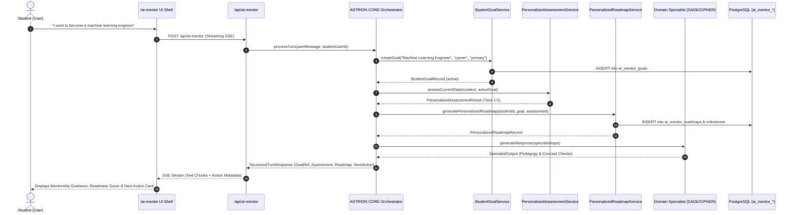

# ASTRION Goal-Centric Mentorship Lifecycle
**Platform:** MentorMaze by AI Tathastu (`mentormaze.aitathastu.com`)  
**AI Mentorship Engine:** ASTRION  
**Document:** End-to-End 7-Stage Continuous Mentorship Lifecycle Specification  
**Status:** `VERIFIED`

---

## 1. The Continuous Mentorship Loop

ASTRION operates not as an episodic Q&A chatbot, but as an ongoing personal mentor that shepherds a student through a continuous 7-stage learning journey:

```
+---------------------------------------------------------------------------------------------------+
|                                  THE 7-STAGE MENTORSHIP CYCLE                                     |
+---------------------------------------------------------------------------------------------------+

     [ STAGE 1: UNDERSTAND STUDENT ]
          | Profile, academic context, verified skills, and consent boundaries
          v
     [ STAGE 2: UNDERSTAND GOAL ]
          | Career, technical, academic, or project targets (Primary vs Secondary)
          v
     [ STAGE 3: ASSESS CURRENT STATE ]
          | 5-Tier Evidence Assessment: Strengths, Gaps, and Zero-Hallucination Questions
          v
     [ STAGE 4: CREATE PERSONALIZED ROADMAP ]
          | Gated multi-week milestones, deliverables, and estimated effort
          v
     [ STAGE 5: GUIDE EXECUTION ]
          | Socratic teaching, code review, conceptual deep-dives (SAGE, CIPHER, ATLAS)
          v
     [ STAGE 6: EVALUATE PROGRESS ]
          | Verification of understanding, project evaluation, milestone completion confirmation
          v
     [ STAGE 7: ADAPT MENTORSHIP ]
          | Dynamic schedule adjustment, accelerated progression, or prerequisite remediation
          |
          +---------------------> [ CONTINUOUS LOOP ] ---------------------+
```

---

## 2. Detailed Lifecycle Stages & System Mechanics

### Stage 1: Understand the Student
- **Input**: Authenticated user session (`studentUserId`), authorized database profile, verified skills in the Student Intelligence Graph, and purpose-specific consents (`service_personalization`, `student_memory`).
- **Processing**: `PermissionAwareContextBuilder.buildContext` aggregates verified skills, projects, and learning history. If the student has restricted consent, private memory is omitted.
- **Output**: An immutable, sanitized `AuthorizedStudentContext` package passed to the lead mentor orchestrator.

### Stage 2: Understand the Goal
- **Input**: Student prompt (e.g. *"I want to become a machine learning engineer"* or explicit goal selection in the UI).
- **Processing**: `StudentGoalService.createGoal` or `getActivePrimaryGoal` retrieves the active focus. If multiple primary goals compete, `detectGoalConflicts` analyzes time commitments and cognitive trade-offs.
- **Output**: Structured `goalReference` bound to the student conversation turn.

### Stage 3: Assess Current State
- **Input**: `AuthorizedStudentContext` compared against canonical benchmark competencies (e.g. 7 core competencies for ML: Python, Linear Algebra, Probability, DSA, PyTorch, Data Pipelines, Model Serving).
- **Processing**: `PersonalizedAssessmentService.assessCurrentState` classifies every prerequisite into one of the 5 Evidence Tiers:
  - *Tier 1 (Confirmed)*: Verified by code or quiz.
  - *Tier 2 (Student-reported)*: Self-reported.
  - *Tier 3 (Extracted)*: Parsed from resume/profile.
  - *Tier 4 (System-inferred)*: Inferred from related skills.
  - *Tier 5 (Unknown/Missing)*: Formulates focused clarifying questions. **Zero hallucination or guessing**.
- **Output**: Readiness score (0–100%), verified strengths, confirmed gaps, and clarifying questions.

### Stage 4: Create Personalized Roadmap
- **Input**: Goal definition + Current State Assessment.
- **Processing**: `PersonalizedRoadmapService.generatePersonalizedRoadmap` generates a sequence of milestones. If the student has already verified mastery in early topics (e.g., Python and Linear Algebra), Week 1 is automatically marked `completed` and the student begins at Week 2.
- **Output**: `PersonalizedRoadmapRecord` containing milestones with learning activities, concrete deliverables, and estimated effort hours.

### Stage 5: Guide Execution
- **Input**: Day-to-day student questions, code snippets, or architecture design queries.
- **Processing**: ASTRION CORE dynamically routes to the appropriate specialist capability (e.g., SAGE for concept explanations, CIPHER for coding/DSA, ATLAS for system design, VECTRA for career strategy) while maintaining ASTRION's singular persona.
- **Output**: Pedagogical response featuring analogies, architectural ASCII diagrams, edge cases, and a concept verification check.

### Stage 6: Evaluate Progress
- **Input**: Student submissions, completed project repositories, or explicit milestone confirmation (e.g., *"I completed week 1 milestone deliverable with my NumPy tensor implementation"*).
- **Processing**: `PersonalizedRoadmapService.markMilestoneProgress` validates the confirmation, marks the milestone as `completed`, records completion timestamp, and activates the next milestone.
- **Output**: Updated milestone progress percentage and updated progress insights.

### Stage 7: Adapt Mentorship
- **Input**: Life events, exam schedules, accelerated student velocity, or persistent blockers.
- **Processing**: `PersonalizedRoadmapService.adaptRoadmap` recalculates timelines, adjusts effort hours, or injects prerequisite remediation milestones, appending the event to `adaptationHistory`.
- **Output**: Adapted roadmap reflected in the persistent database and streamed via SSE to the `/ai-mentor` workspace.

---

## 3. Interaction Sequence Diagram


