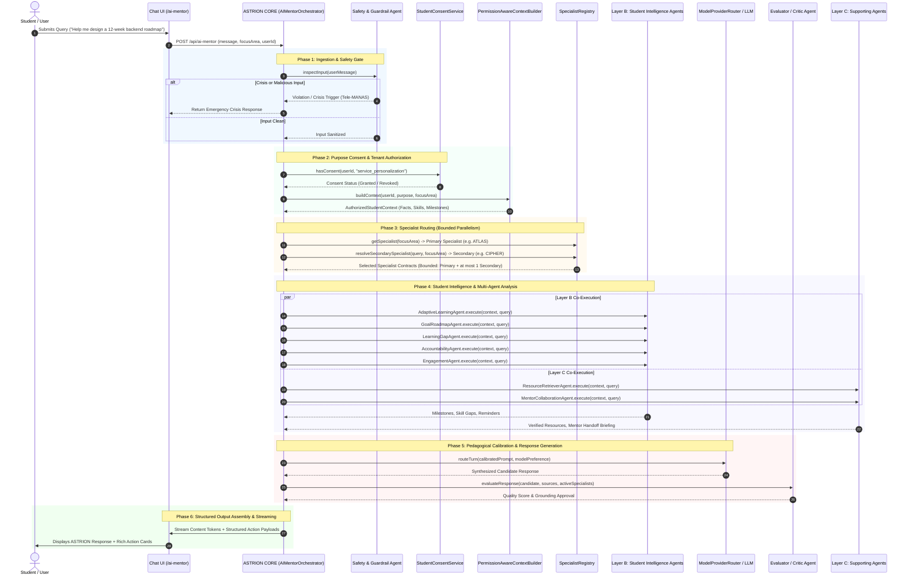

# ASTRION Orchestration Flow & Runtime Lifecycle

**Product:** MentorMaze by AI Tathastu (`mentormaze.aitathastu.com`)  
**AI System:** ASTRION — Adaptive Strategic Intelligence & Reasoning Network (`astrion-core`)  
**Version:** 2.0.0  
**Timestamp:** 2026-11-22  

---

## 1. Architectural Purpose & Single-Orchestrator Contract

ASTRION enforces a **single lead mentor orchestrator architecture** (`AIMentorOrchestrator`). Instead of routing students to isolated, independent bots, every turn passes through a centralized, permission-aware pipeline that:
1. Validates authentication and purpose-specific consent.
2. Sanitizes input and detects crisis/prompt-injection boundaries.
3. Classifies student intent and selects domain specialist capabilities (bounded parallelism).
4. Assembles a strictly minimized student context package.
5. Invokes student intelligence and supporting agents.
6. Synthesizes a unified response from ASTRION.
7. Packages structured action payloads (study plans, skill gaps, verified resources, reminders, and mentor handoffs).

---

## 2. End-to-End Orchestration Sequence Diagram

---

## 3. Step-by-Step Lifecycle Specification

### Step 1: Authentication & Tenant Authorization
- Every turn requires a validated `studentUserId`.
- If `requestingUserId !== studentUserId` and the caller is not an authorized mentor or administrator, the request is immediately rejected with `403_FORBIDDEN`.

### Step 2: Safety & Guardrail Gate (`SafetyGuardrails`)
- **Clinical Crisis Check:** Detects signals of acute depression, crisis, or self-harm. Immediately halts processing and returns the national Tele-MANAS helpline (`14416` / `1800-891-4416`).
- **Prompt-Injection Neutralization:** Strips chat delimiter tokens (`<|im_start|>`, `<|system|>`, instruction wrappers) and role markers before prompts reach model layers.

### Step 3: Purpose-Specific Consent Resolution (`StudentConsentService`)
- Evaluates student consent across 7 granular purposes (`service_personalization`, `student_memory`, `external_data_integration`, `external_llm_processing`, `model_training`, `mentor_sharing`, `analytics_evaluation`).
- **Default Policy Rule:** `model_training` is strictly `false` by default.
- If `service_personalization` is revoked, context collection falls back to a generic, unpersonalized mode.

### Step 4: Intent Understanding & Specialist Routing (`SpecialistRegistry`)
- Maps the student query and requested `focusArea` to one of the 8 canonical specialists:
  - `learn` → **SAGE**
  - `coding_dsa` → **CIPHER**
  - `system_design` → **ATLAS**
  - `projects` → **FORGE**
  - `career` → **VECTRA**
  - `resume` → **PRISM**
  - `interview` → **ORACLE**
  - `study_planning` → **CHRONOS**
- **Bounded Secondary Resolution:** Calls `resolveSecondarySpecialist`. If the query spans multiple domains (e.g. system design code), at most one secondary specialist is attached. Spawning recursive subagents is structurally impossible.

### Step 5: Minimized Context Construction (`PermissionAwareContextBuilder`)
- Aggregates the student intelligence graph:
  - Confirmed facts vs student-reported hypotheses.
  - Active verified skills and mastery scores.
  - Current milestone progress.
  - Authorized memory items.
- Neutralizes markdown code fences in student context to prevent prompt breakout.

### Step 6: Multi-Agent Co-Execution (Layers B & C)
- Executes Student Intelligence Agents in bounded parallelism:
  - `AdaptiveLearningAgent`: Calibrates pacing factor and validates prerequisites.
  - `LearningGapAgent`: Identifies confirmed vs suspected competency gaps against SDE benchmarks.
  - `GoalRoadmapAgent`: Assembles structured milestone roadmap.
  - `AccountabilityAgent`: Schedules supportive, non-guilt-based check-ins.
  - `EngagementAgent`: Distinguishes conceptual learning depth from raw activity volume.
  - `ResourceRetrieverAgent`: Performs verified curriculum RAG retrieval (zero fake URLs).
  - `MentorCollaborationAgent`: Evaluates struggle triggers for human mentor handoff.

### Step 7: Pedagogical Calibration & Prompt Enrichment
- Embeds Socratic pedagogical principles into system prompt:
  1. Calm intellectual authority and single unified ASTRION identity.
  2. Socratic scaffolding (progressive hints before complete solutions).
  3. Zero-Fabrication rule on resumes and credentials.
  4. Groundedness in verified computer science curriculum standards.

### Step 8: Multi-Provider LLM Routing & Safe Fallback (`ModelProviderRouter`)
- Routes to preferred model engine (Gemini, Claude, GPT-4o, or local MentorMaze-2B).
- If external providers or local daemons are unavailable, falls back gracefully to the local deterministic pedagogical rules engine with transparent fallback reasoning.

### Step 9: Evaluator / Critic Quality Gate (`EvaluatorCriticAgent`)
- Audits synthesized response:
  - Checks for cross-specialist contradictions.
  - Enforces Big-O complexity requirements on code.
  - Flags ungrounded resume claims.
  - Minimum quality threshold: Score ≥ 7.0/10.0.

### Step 10: Structured Output Assembly & Streaming
- Emits response text to the student along with structured action cards:
  - `studyPlan`: Milestones, deliverables, and estimated effort hours.
  - `progressInsights`: Confirmed strengths, confirmed gaps with remediation suggestions.
  - `resources`: Verified curriculum reference links.
  - `reminders`: Milestone check-in prompts.
  - `mentorHandoff`: Human consultation booking briefing if eligible.
