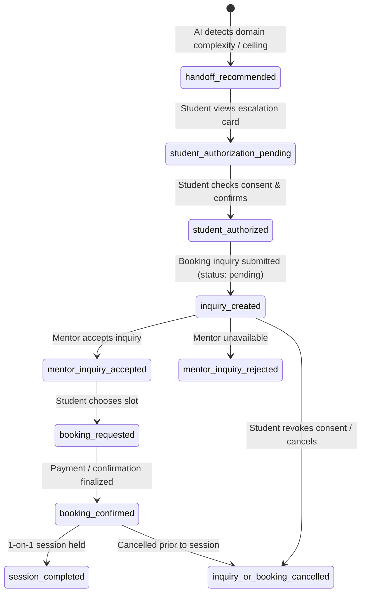

# ASTRION Phase 4.1.1 — Human Mentor Handoff State Machine

**Platform:** MentorMaze by AI Tathastu  
**AI System:** ASTRION — Adaptive Strategic Intelligence & Reasoning Network  
**Workspace:** `/ai-mentor`  
**Phase:** 4.1.1  
**Status:** VERIFIED  

---

## 1. State Machine Definition

ASTRION provides human mentor escalation when a student encounters topics exceeding purely algorithmic mentorship (e.g., complex distributed consensus debugging, architecture reviews, mock interviews).

The lifecycle is modeled as a 10-state deterministic state machine:



### 1.1 Complete State List
1. `handoff_recommended`: ASTRION identifies that human expert input is required.
2. `student_authorization_pending`: Briefing is staged, waiting for explicit student opt-in.
3. `student_authorized`: Student has confirmed data sharing for this session.
4. `inquiry_created`: Booking inquiry created in MentorMaze store with `status: "pending"`.
5. `mentor_inquiry_accepted`: Mentor reviews sanitized brief and accepts inquiry.
6. `mentor_inquiry_rejected`: Mentor declines or proposes alternate time.
7. `booking_requested`: Specific time slot requested.
8. `booking_confirmed`: Slot confirmed and added to mentor/student calendars.
9. `session_completed`: 1-on-1 session held; post-session debrief fed back to ASTRION.
10. `inquiry_or_booking_cancelled`: Consent revoked or inquiry cancelled by student/mentor.

---

## 2. Inquiry vs. Confirmed Booking Distinction

A critical integrity requirement is that **creating an inquiry must NEVER be misrepresented as a confirmed booking**:
- In `app/api/ai-mentor/handoff/route.ts`:
  ```typescript
  isConfirmedBooking: false,
  inquiryStatus: "pending_mentor_review"
  ```
- In the booking store (`lib/data/store.ts`):
  ```typescript
  createdBooking.status = "pending";
  createdBooking.paymentStatus = "pending";
  ```
- In UI (`components/ai-mentor/ai-mentor-handoff-card.tsx`):
  The card explicitly indicates that the request is pending mentor review and verification of availability.

---

## 3. Immutable Handoff Audit Trail

Every state transition and access attempt is appended to `handoffAuditTrail`:
```typescript
export interface HandoffAuditRecord {
  id: string;
  studentUserId: string;
  action: "RECOMMENDED" | "AUTHORIZED" | "INQUIRY_CREATED" | "CONSENT_REVOKED" | "ACCESS_ATTEMPT";
  actorUserId: string;
  actorRole: string;
  state: HandoffLifecycleState;
  notes?: string;
  timestamp: string;
}
```

Audit records are logged on:
- Escalation recommendation.
- Student authorization.
- Inquiry creation.
- Every read access by a mentor or student.
- Student consent revocation.

---

## 4. Verification Evidence

In `tests/ai-mentor-phase4-1-1-integrity.test.ts`:
- **Initial State**: Confirmed `student_authorization_pending` with `hasConsent: false`.
- **Invalid Auth**: POST with `authorized: false` returns `400 Bad Request`.
- **Authorized Handoff**: POST with `authorized: true` transitions to `inquiry_created`, creates pending booking, and returns `isConfirmedBooking: false`.
- **Mentor Read**: Verified approved mentor can read sanitized briefing while authorized.
- **Instant Revocation**: DELETE immediately revokes consent, updates audit trail, and causes subsequent mentor reads to return `403 Forbidden`.
- **Multi-Tenant Defense**: Verified Student B cannot view Student A's handoff briefing (`403 Forbidden`).
