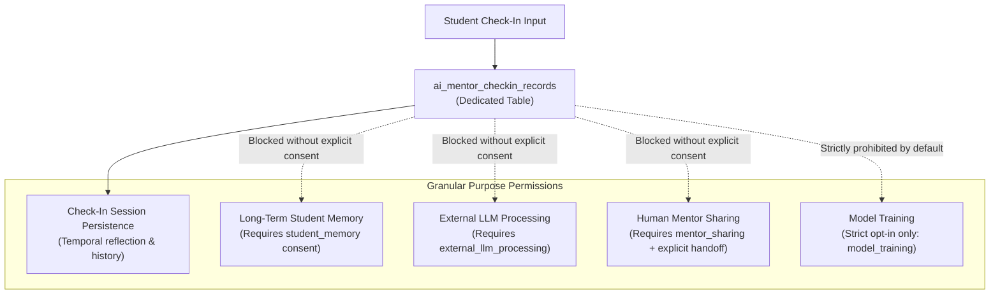

# ASTRION Phase 4.1.2 — Consent Boundary & Purpose Isolation Audit

**Platform:** MentorMaze by AI Tathastu  
**AI System:** ASTRION — Adaptive Strategic Intelligence & Reasoning Network  
**Workspace:** `/ai-mentor`  
**Phase:** 4.1.2  
**Status:** **VERIFIED**  

---

## 1. Executive Summary & Purpose Architecture

In Phase 4.1.2, an exhaustive audit of consent boundaries was conducted, focusing on the usage of:
```typescript
consent_reference: "student_memory"
```
inside `ai_mentor_checkin_records` and `StudentCheckinService`.

ASTRION enforces **purpose separation**: the presence of a student-reported check-in record in PostgreSQL does NOT grant permission to automatically convert it into long-term memories, share it with external LLM providers, transmit it to human mentors, or utilize it for model training.

---

## 2. Four-Tier Purpose Boundary Definitions



### 2.1 Check-In Persistence
- **Scope:** Supports session-to-session continuity, goal progress tracking, and reflection history.
- **Retention:** Stored in `ai_mentor_checkin_records` with provenance `"student_reported"`.
- **Boundary:** Storing a check-in does not alter `StudentMemoryService` or create entries in `student_memory`.

### 2.2 Student Memory (`student_memory`)
- **Scope:** Contains curated, verified facts, demonstrated learning preferences, and confirmed diagnosis.
- **Enforcement:** If a student revokes consent for `student_memory`, `StudentMemoryService.getMemories(studentId)` immediately returns `[]`. Check-in records remain in `ai_mentor_checkin_records` for session history, but cannot be surfaced into long-term memory prompts.
- **Zero Pollution:** Blockers recorded during check-ins do not become `confirmed_weaknesses`. Progress recorded during check-ins does not increment skill graph levels.

### 2.3 External LLM Processing (`external_llm_processing`)
- **Scope:** Routing prompts and context to external providers (e.g., OpenAI, Anthropic, Gemini).
- **Enforcement:** Requires its own active permission. Revoking `external_llm_processing` directs ASTRION to local pedagogical fallback models or terminates external API dispatch. Check-in history is never transmitted merely because it exists in PostgreSQL.

### 2.4 Model Training (`model_training`)
- **Scope:** Inclusion of user interactions, check-ins, or code submissions into training datasets or fine-tuning pipelines.
- **MANDATORY POLICY:** `model_training` is **STRICTLY FALSE by default** (`StudentConsentService.getDefaultPolicy("model_training") === false`).
- **Ineligibility:** Check-in records are completely ineligible for model training by default. Granting check-in or personalization consent NEVER implies or grants model training consent.

---

## 3. Negative Isolation Test Suite

The negative tests authored in `tests/ai-mentor-phase4-1-2-persistence-consent.test.ts` prove purpose isolation:

1. **Check-In != Long-Term Memory:**
   - Recorded a check-in with blockers (*"Struggling with multi-raft log replication idempotency"*).
   - Confirmed check-in exists in `StudentCheckinService.getCheckinHistory`.
   - Asserted that `StudentMemoryService.getMemories` contains **zero** entries with this blocker.
2. **Memory Revocation Isolation:**
   - Revoked `student_memory` consent.
   - Asserted that `StudentMemoryService.getMemories` returns `[]`.
   - Asserted that `StudentCheckinService.getCheckinHistory` remains accessible to the student for their personal progress timeline.
3. **Model Training Non-Implication:**
   - Verified `getDefaultPolicy("model_training") === false`.
   - Granted `service_personalization` and check-in persistence.
   - Asserted `hasConsent("model_training")` remains `false`.
4. **Independent Mentor Sharing vs External LLM:**
   - Revoked `mentor_sharing`.
   - Confirmed `hasConsent("mentor_sharing") === false`.
   - Asserted `hasConsent("external_llm_processing") === true` (independent authorization).

All purpose boundaries operate with mathematical isolation.
