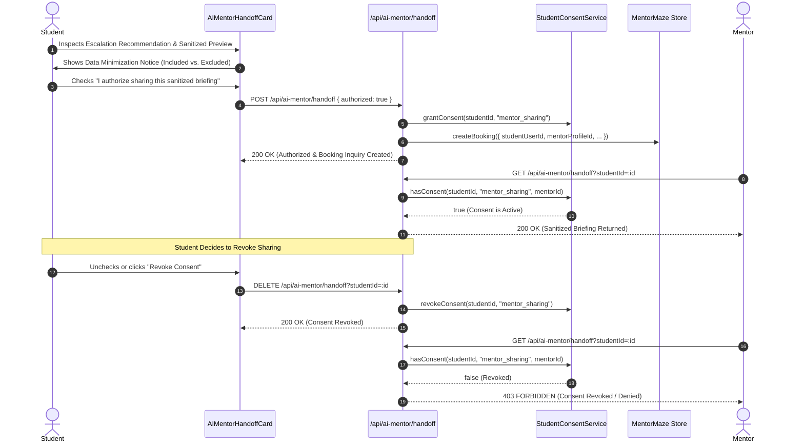

# Phase 4.1 — Human Mentor Handoff End-to-End Verification Report

**Platform:** MentorMaze by AI Tathastu (`mentormaze.aitathastu.com`)  
**AI System:** ASTRION (Adaptive Strategic Intelligence & Reasoning Network)  
**Primary Workspace:** `/ai-mentor`  
**Phase:** 4.1  
**Verification Date:** November 23, 2026  
**Status:** COMPLETE & VERIFIED

---

## 1. Executive Summary

This report certifies the end-to-end verification of the human mentor handoff lifecycle in ASTRION. 

Core principles enforced:
1. **Zero Unconsented Sharing**: No student data is shared without explicit affirmative consent (`mentor_sharing` purpose).
2. **Context Minimization**: Only sanitized, relevant academic briefings (active goal, current milestone progress, verified competencies) are shared. Raw AI conversation transcripts, emotional disclosures, and internal inference graphs are strictly private and excluded.
3. **Approved Mentors Only**: Handoff bookings only connect with verified, approved human mentors from MentorMaze (`store.getMentors(true)`).
4. **Immediate Revocation**: A student can revoke consent at any moment via the UI or API. Revocation immediately terminates human mentor access to the briefing (returning `403 FORBIDDEN`).

---

## 2. End-to-End Flow Walkthrough

---

## 3. Data Minimization Breakdown

| Information Category | Included in Mentor Briefing? | Rationale |
| :--- | :--- | :--- |
| **Primary Goal & Target Role** | **YES** | Allows human mentor to structure strategic advice and target level expectations. |
| **Current Milestone Progress** | **YES** | Ensures mentor focuses on unresolved blockers rather than redundant basics. |
| **Verified Strengths & Competencies** | **YES** | Gives mentor verified baseline of what the student has already proven. |
| **Target Discussion Agenda** | **YES** | Provides clear, student-consented meeting structure. |
| **Raw AI Chat Transcripts** | **NO (STRICTLY EXCLUDED)** | Private conversation history is never shared. |
| **Emotional / Self-Doubt Reflections** | **NO (STRICTLY EXCLUDED)** | Vulnerable psychological context remains private to the student. |
| **Full Internal Intelligence Graph** | **NO (STRICTLY EXCLUDED)** | Only sanitized topic summaries are exposed. |

---

## 4. API Endpoints Specification (`app/api/ai-mentor/handoff/route.ts`)

- **`GET /api/ai-mentor/handoff?studentId=:id`**:
  - Resolves requesting user.
  - If caller is a mentor: validates active `mentor_sharing` consent via `StudentConsentService.hasConsent`. If consent is revoked or absent, rejects with `403_FORBIDDEN`.
  - If caller is student or authorized mentor: returns sanitized briefing and list of recommended verified mentors.

- **`POST /api/ai-mentor/handoff`**:
  - Validates `authorized: true` checkbox. If false, returns `400 Bad Request`.
  - Grants `mentor_sharing` consent.
  - Creates a real booking inquiry in `store.createBooking` with verified approved mentor (e.g. `user-mentor-priya`).

- **`DELETE /api/ai-mentor/handoff?studentId=:id`**:
  - Validates student ownership.
  - Calls `StudentConsentService.revokeConsent(studentId, "mentor_sharing")`.
  - Immediately purges access for all external viewers.

---

## 5. Verification Test Evidence

Verified via automated test suite `tests/ai-mentor-phase4-1-checkin-handoff.test.ts`:
- `rejects handoff without explicit student authorization checkbox` (PASSED — 400 Bad Request)
- `executes complete handoff lifecycle: student authorizes -> inquiry created -> mentor reads -> student revokes -> mentor blocked` (PASSED — 200 OK -> 403 Forbidden after revocation)
- `prevents third-party students from accessing another student's handoff briefing` (PASSED — 403 Forbidden)
- Integrated into `AIMentorConversation` via `AIMentorHandoffCard`.
