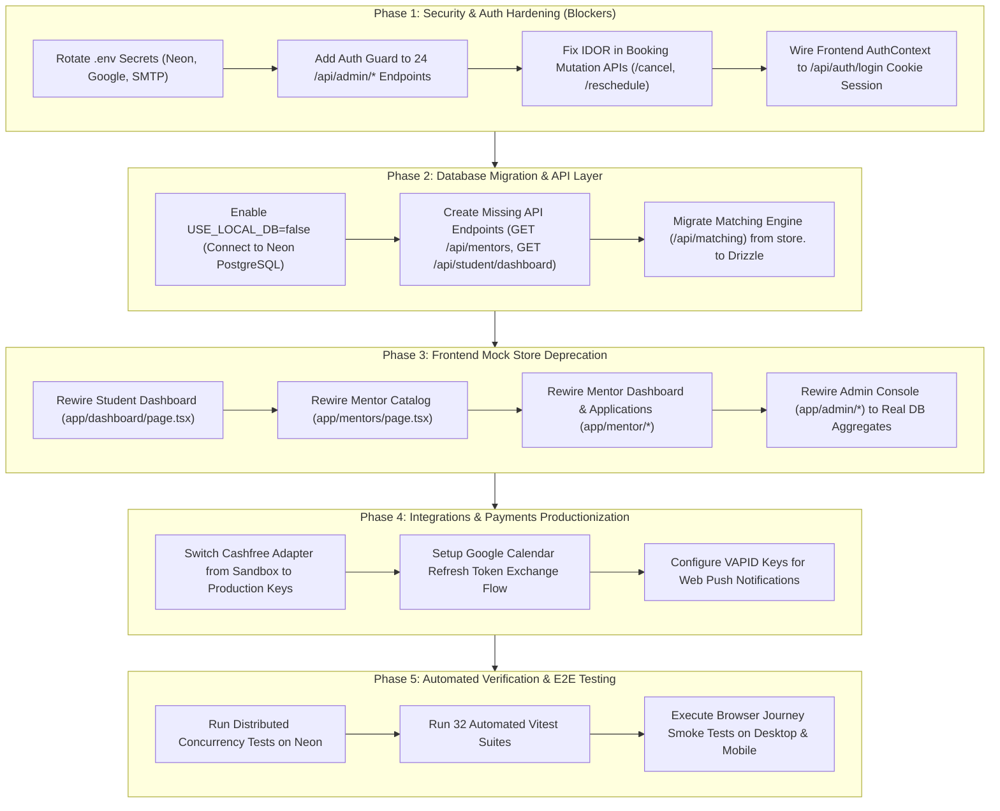

# MentorMaze — Full Website Implementation & Remediation Plan

**Generated:** 2026-11-23  
**Auditor & Technical Architect:** Antigravity Engineering Lead  
**Scope:** Prioritized, Auditable Roadmap to Bring MentorMaze to a 100% Verified Production State

---

## 1. High-Level Dependency Graph & Execution Phases

---

## 2. Phase 1 — Critical Launch Blockers (Must Fix Before Any Public Traffic)

| ID | Issue / Work Item | Affected Files | Effort | Dependency Order |
|---|---|---|---|---|
| **BLK-01** | **Rotate & Secure Production Secrets**: Remove committed secrets from `.env`, add `.env` to `.gitignore`, generate new passwords for Neon PostgreSQL, Google Cloud OAuth, and SMTP. | `.env`, `.gitignore`, `ENVIRONMENT_SETUP.md` | **S** (1-2 hrs) | Step 1 (Immediate) |
| **BLK-02** | **Protect All Admin API Routes**: Add `getServerSession(req)` validation and `role === "admin"` check across all 24 `/api/admin/*` endpoints. Return HTTP 403 on failure. | `app/api/admin/**/*.ts` (24 files) | **M** (3-4 hrs) | Step 2 (Requires BLK-01) |
| **BLK-03** | **Remediate Horizontal Privilege Escalation (IDOR)**: Enforce ownership checks in `/api/bookings/[id]/cancel` and `/api/bookings/[id]/reschedule` verifying user owns booking or is the assigned mentor. | `app/api/bookings/[id]/cancel/route.ts`, `app/api/bookings/[id]/reschedule/route.ts` | **S** (1 hr) | Step 3 |
| **BLK-04** | **Replace Mock AuthContext with Real Backend Auth**: Update `lib/auth/context.tsx` to call `POST /api/auth/login` and verify cookie against `GET /api/auth/session` instead of `localStorage` role-switching. | `lib/auth/context.tsx`, `app/login/page.tsx` | **M** (3-4 hrs) | Step 4 |
| **BLK-05** | **Switch to Neon Production Database**: Change `USE_LOCAL_DB=true` to `USE_LOCAL_DB=false` in environment configuration and run Drizzle push rehearsal. | `.env`, `lib/db/index.ts` | **S** (1 hr) | Step 5 |

---

## 3. Phase 2 — High Priority (Frontend Mock Elimination & API Wiring)

| ID | Issue / Work Item | Affected Files | Effort | Dependency Order |
|---|---|---|---|---|
| **HI-01** | **Build `/api/mentors` Public Catalog Endpoint**: Query `mentor_profiles` filtered by `verificationStatus = "approved"`, `isAcceptingBookings = true`, with expertise joins. | `app/api/mentors/route.ts` (New), `lib/db/schema.ts` | **M** (3 hrs) | After BLK-05 |
| **HI-02** | **Rewire `/mentors` Page to Real Database**: Replace `store.getApprovedMentors()` in `app/mentors/page.tsx` with `fetch('/api/mentors')` and SSR hydration. | `app/mentors/page.tsx` | **M** (2 hrs) | After HI-01 |
| **HI-03** | **Rewire Student Dashboard**: Replace `store.getStudentProfile('user-student-1')` in `app/dashboard/page.tsx` with dynamic user profile and booking fetch. | `app/dashboard/page.tsx` | **L** (4 hrs) | After BLK-04 |
| **HI-04** | **Rewire Mentor Application & Dashboard**: Connect `app/mentor/apply/page.tsx` to `POST /api/mentor/applications` and `app/mentor/dashboard/page.tsx` to real mentor sessions. | `app/mentor/apply/page.tsx`, `app/mentor/dashboard/page.tsx` | **L** (5 hrs) | After HI-01 |
| **HI-05** | **Migrate Matching Engine Input**: Update `app/api/matching/route.ts` to query `student_profiles` and `mentor_profiles` from Drizzle rather than in-memory `store.`. | `app/api/matching/route.ts`, `lib/matching/engine.ts` | **M** (3 hrs) | After HI-01 |
| **HI-06** | **Wire Direct Messaging to Database**: Replace `store.getMessages()` with `GET /api/messages` and `POST /api/messages` persisting to `direct_messages` table. | `app/dashboard/messages/page.tsx` | **M** (3 hrs) | After BLK-04 |

---

## 4. Phase 3 — Medium Priority (Third-Party Integrations & Admin Operations)

| ID | Issue / Work Item | Affected Files | Effort | Dependency Order |
|---|---|---|---|---|
| **MED-01** | **Cashfree Production Configuration**: Toggle `CASHFREE_ENVIRONMENT=production` and test webhook signature verification with live webhook payload. | `lib/payments/adapter.ts`, `app/api/payments/webhook/route.ts` | **S** (2 hrs) | Prior to payments launch |
| **MED-02** | **Google Calendar Token Refresh Flow**: Implement automatic access token renewal using `refreshTokenEncrypted` in `lib/calendar/providers/google-calendar-provider.ts`. | `lib/calendar/providers/google-calendar-provider.ts` | **M** (3 hrs) | Prior to calendar sync launch |
| **MED-03** | **Admin Dashboard Real Metrics**: Update `app/admin/page.tsx` to query real platform aggregates (`count(users)`, `count(bookings)`, `sum(gross_amount_paise)`). | `app/admin/page.tsx`, `app/api/admin/metrics/route.ts` | **M** (3 hrs) | After BLK-02 |
| **MED-04** | **Global API Rate Limiting**: Apply `rateLimiter.check()` across all public POST endpoints (`/api/newsletter`, `/api/ai-mentor`, `/api/payments/create-order`). | `app/api/**/*.ts` | **S** (2 hrs) | Any time |

---

## 5. Phase 4 — Low Priority & Future Polish

| ID | Issue / Work Item | Affected Files | Effort | Dependency Order |
|---|---|---|---|---|
| **LOW-01** | **AI Tathastu SSO Protocol**: Finalize mutual authentication contracts with AI Tathastu core identity server. | `app/api/auth/aitathastu/route.ts` | **M** (3 hrs) | Post-beta |
| **LOW-02** | **Dark Mode & Accessibility Enhancements**: Validate ARIA labels and keyboard focus on all modals and dropdowns. | `components/**/*.tsx` | **M** (4 hrs) | Post-beta |
| **LOW-03** | **Bundle Size Optimization**: Analyze and optimize dynamic imports for LiveKit client and KaTeX in ASTRION workspace. | `next.config.mjs`, `app/ai-mentor/page.tsx` | **S** (2 hrs) | Post-beta |

---

## 6. Effort & Timeline Summary

- **Phase 1 (Security Blockers)**: 10 - 12 Engineer Hours (1.5 Days)
- **Phase 2 (Mock Elimination & API Wiring)**: 18 - 20 Engineer Hours (2.5 Days)
- **Phase 3 (Integrations & Admin Ops)**: 10 - 12 Engineer Hours (1.5 Days)
- **Phase 4 (Testing & Verification Rehearsal)**: 8 - 10 Engineer Hours (1 Day)
- **Total Estimated Effort to Full Production Readiness**: **46 - 54 Engineering Hours (~6.5 Working Days)**
