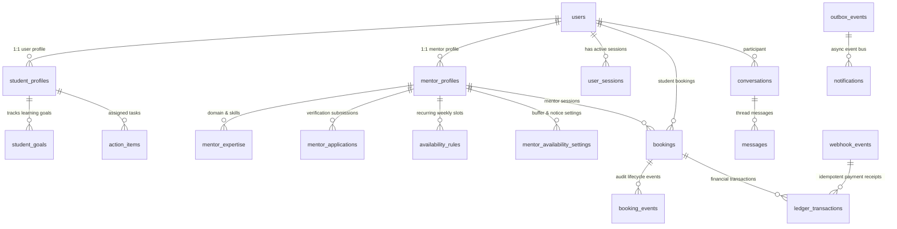

# MentorMaze — Phase 2, 2.1 & 2.2: Database Mapping & Schema Reference

**Product:** MentorMaze by AI Tathastu  
**Domain:** https://mentormaze.aitathastu.com  
**AI Mentor:** ASTRION  
**Scope:** Core Student and Mentor Experience Database Persistence, Concurrency & Payment Schema  
**ORM:** Drizzle ORM  
**Dialect:** PostgreSQL (with WASM PGlite in-memory fallback for hermetic test execution)  
**Date:** November 2026  

---

## 1. Schema Architecture Overview

Phase 2, 2.1, and 2.2 connect the core student and mentor journeys directly to PostgreSQL tables defined in `lib/db/schema.ts`. No synthetic mock records or hardcoded data store arrays remain in active production paths.



---

## 2. Detailed Table Specifications

### 2.1 `users`
- **Table Name:** `users`
- **Columns:**
  - `id` (`uuid`, Primary Key, default random)
  - `email` (`varchar(255)`, Unique, Not Null)
  - `password_hash` (`varchar(255)`, Bcrypt-12 or Argon2id, Nullable for OAuth)
  - `display_name` (`varchar(160)`, Not Null)
  - `avatar_url` (`text`, Nullable)
  - `role` (`varchar(32)`, Default `'student'`, Values: `student`, `mentor`, `admin`, `super_admin`)
  - `account_status` (`varchar(32)`, Default `'active'`, Values: `active`, `suspended`, `closed`)
  - `timezone` (`varchar(64)`, Default `'Asia/Kolkata'`)
  - `created_at`, `updated_at` (`timestamp with time zone`)

### 2.2 `mentor_profiles` & `mentor_expertise`
- **Table Name:** `mentor_profiles`
- **Columns:**
  - `id` (`uuid`, Primary Key)
  - `user_id` (`uuid`, Foreign Key references `users.id`, Cascade Delete, Unique)
  - `headline` (`varchar(255)`, Not Null, e.g. "Software Engineer @ Microsoft")
  - `bio` (`text`, Not Null)
  - `organization` (`varchar(255)`, Not Null)
  - `"current_role"` (`varchar(255)`, Not Null — quoted due to SQL keyword)
  - `years_of_experience` (`integer`, Not Null, Default 1)
  - `location` (`varchar(160)`, Default `'India'`)
  - `rating` (`numeric(3, 2)`, Default `5.00`)
  - `total_sessions` (`integer`, Default 0)
  - `total_mentees` (`integer`, Default 0)
  - `verification_status` (`varchar(32)`, Default `'submitted'`, Values: `draft`, `submitted`, `under_review`, `approved`, `rejected`, `suspended`)
  - `is_accepting_bookings` (`boolean`, Default `true`)
  - `languages` (`jsonb`, Default `["English"]`)
  - `session_modes` (`jsonb`, Default `["1:1"]`)
  - `price_15min_inr`, `price_30min_inr`, `price_60min_inr` (`integer`)
- **Table Name:** `mentor_expertise`
- **Columns:**
  - `id` (`uuid`, Primary Key)
  - `mentor_profile_id` (`uuid`, Foreign Key references `mentor_profiles.id`, Cascade Delete)
  - `primary_domain` (`varchar(120)`, Not Null)
  - `skills` (`jsonb`, array of strings)
  - `focus_areas` (`jsonb`, array of strings)

### 2.3 `mentor_applications`
- **Table Name:** `mentor_applications`
- **Columns:**
  - `id` (`uuid`, Primary Key)
  - `mentor_profile_id` (`uuid`, Foreign Key references `mentor_profiles.id`, Cascade Delete)
  - `status` (`varchar(32)`, Default `'submitted'`, Values: `submitted`, `under_review`, `approved`, `rejected`)
  - `identity_proof_type` (`varchar(64)`)
  - `professional_proof_type` (`varchar(64)`)
  - `resume_url` (`text`)
  - `linkedin_url` (`text`)
  - `admin_notes` (`text` — strictly excluded from applicant projections)
  - `rejection_reason` (`text`, Nullable)
  - `created_at`, `updated_at` (`timestamp with time zone`)

### 2.4 `student_profiles` & `student_goals`
- **Table Name:** `student_profiles`
- **Columns:**
  - `id` (`uuid`, Primary Key)
  - `user_id` (`uuid`, Foreign Key references `users.id`, Cascade Delete, Unique)
  - `target_role` (`varchar(255)`, e.g. "Software Engineer")
  - `institution` (`varchar(255)`)
  - `degree` (`varchar(160)`)
  - `current_level` (`varchar(64)`)
  - `bio` (`text`)
- **Table Name:** `student_goals`
- **Columns:**
  - `id` (`uuid`, Primary Key)
  - `student_profile_id` (`uuid`, Foreign Key references `student_profiles.id`, Cascade Delete)
  - `title` (`varchar(255)`, Not Null)
  - `description` (`text`)
  - `category` (`varchar(64)`, e.g. "interview", "project", "career")
  - `status` (`varchar(32)`, Default `'in_progress'`)
  - `progress_percentage` (`integer`, Default 0)
  - `target_date` (`timestamp with time zone`)

### 2.5 `bookings` & `booking_events`
- **Table Name:** `bookings`
- **Columns:**
  - `id` (`uuid`, Primary Key)
  - `student_user_id` (`uuid`, Foreign Key references `users.id`)
  - `mentor_profile_id` (`uuid`, Foreign Key references `mentor_profiles.id`)
  - `service_type` (`varchar(64)`, e.g. `'1on1_mentorship'`, `'mock_interview'`)
  - `session_duration_minutes` (`integer`, Not Null)
  - `start_time_utc` (`timestamp with time zone`, Not Null)
  - `end_time_utc` (`timestamp with time zone`, Not Null)
  - `status` (`varchar(32)`, Values: `pending`, `confirmed`, `completed`, `cancelled`, `rescheduled`, `expired`)
  - `payment_status` (`varchar(32)`, Values: `free`, `pending`, `paid`, `refund_pending`, `refunded`, `partially_refunded`, `failed`, `cancelled`)
  - `meeting_room_id` (`varchar(128)`, Unique session room identifier)
  - `cancellation_reason` (`text`, Nullable)
  - `student_discussion_points` (`text`, Nullable)
- **Table Name:** `booking_events`
- **Columns:**
  - `id` (`uuid`, Primary Key)
  - `booking_id` (`uuid`, Foreign Key references `bookings.id`, Cascade Delete)
  - `event_type` (`varchar(64)`, e.g. `'transition_to_confirmed'`, `'transition_to_cancelled'`, `'refund_initiated'`, `'admin_availability_override'`)
  - `from_status` (`varchar(32)`)
  - `to_status` (`varchar(32)`)
  - `actor_id` (`uuid`, Foreign Key references `users.id`, Nullable)
  - `actor_role` (`varchar(32)`)
  - `metadata` (`jsonb`)
  - `created_at` (`timestamp with time zone`, Default `now()`)

### 2.6 `ledger_transactions` & `journal_entries`
- **Table Name:** `ledger_transactions`
- **Columns:**
  - `id` (`uuid`, Primary Key)
  - `booking_id` (`uuid`, Foreign Key references `bookings.id`)
  - `student_user_id` (`uuid`, Foreign Key references `users.id`)
  - `mentor_profile_id` (`uuid`, Foreign Key references `mentor_profiles.id`)
  - `currency` (`varchar(3)`, Default `'INR'`)
  - `gross_amount_inr` (`integer`, Not Null)
  - `gross_amount_paise` (`integer`)
  - `platform_commission_percent` (`numeric(5, 2)`, Default `15.00`)
  - `platform_fee_inr` (`integer`, Not Null)
  - `mentor_payable_inr` (`integer`, Not Null)
  - `status` (`varchar(32)`, Values: `pending`, `paid`, `refund_pending`, `refunded`, `partially_refunded`, `cancelled`, `settled`)
  - `payment_provider` (`varchar(32)`, Default `'cashfree'`)
  - `provider_order_id` (`varchar(128)`)
  - `provider_payment_id` (`varchar(128)`)
  - `refund_amount_inr` (`integer`, Nullable)
  - `refund_reason` (`text`, Nullable)
  - `settled_at` (`timestamp with time zone`, Nullable)
  - `created_at` (`timestamp with time zone`, Default `now()`)

### 2.7 `webhook_events` & `outbox_events`
- **Table Name:** `webhook_events`
- **Columns:**
  - `id` (`uuid`, Primary Key)
  - `provider` (`varchar(32)`, Default `'cashfree'`)
  - `event_id` (`varchar(128)`, Unique, Not Null)
  - `order_id` (`varchar(128)`)
  - `event_type` (`varchar(64)`)
  - `raw_payload` (`text`)
  - `status` (`varchar(32)`, Default `'processed'`)
  - `created_at` (`timestamp with time zone`, Default `now()`)
- **Table Name:** `outbox_events`
- **Columns:**
  - `id` (`uuid`, Primary Key)
  - `event_type` (`varchar(64)`, e.g. `'booking.confirmed'`, `'booking.cancelled'`, `'chat.message_sent'`, `'availability.admin_override_conflict'`)
  - `payload` (`jsonb`, Not Null)
  - `status` (`varchar(32)`, Default `'pending'`, Values: `pending`, `processed`, `failed`)
  - `retry_count` (`integer`, Default 0)
  - `created_at` (`timestamp with time zone`, Default `now()`)

---

## 3. Concurrency Strategy: PGlite vs. Production PostgreSQL

### 3.1 Limitations of Process-Local Locks (`MentorLockManager`)
`MentorLockManager` chains promises onto an in-memory `Map<string, Promise<void>>`. In a single Node.js thread, this avoids thread contention. However, in any horizontally scaled architecture (multi-process clusters, Docker containers, or serverless Vercel runtimes), different processes do not share memory. Therefore, application-level mutexes cannot guarantee correctness across instances.

### 3.2 Database Row-Level Locking Architecture
Cross-instance mutual exclusion is enforced directly at the PostgreSQL layer:
1. Every schedule-mutating transaction (`createBookingInDb`, `mentorDashboardPostHandler` for accept/decline, and `AvailabilityService.updateMentorSchedule`) initiates an ACID transaction (`db.transaction`).
2. The transaction immediately acquires an exclusive row-level lock on the target mentor profile:
   ```sql
   SELECT id FROM mentor_profiles WHERE id = ${mentorProfileId} FOR UPDATE;
   ```
3. In PostgreSQL, any competing transaction attempting to book, accept, decline, or modify availability for that mentor will block on this row lock until the first transaction completes.
4. Inside the locked critical section:
   - Target booking is locked: `SELECT ... FROM bookings WHERE id = ${bookingId} FOR UPDATE;`
   - Canonical status transition is evaluated via `BookingStateMachine`.
   - Overlap query verifies no other confirmed session collides:
     ```sql
     SELECT id FROM bookings
     WHERE mentor_profile_id = ${mentorProfileId}
       AND status = 'confirmed'
       AND id != ${bookingId}
       AND start_time_utc < ${newEndTime}
       AND end_time_utc > ${newStartTime}
     LIMIT 1;
     ```
   - State transition, `booking_events`, and `outbox_events` are committed atomically.

### 3.3 Test Environment (PGlite) vs. Production (Neon / RDS)
- **PGlite (WASM in-memory)**: Emulates PostgreSQL row locks and transaction rollbacks within the Node.js memory space. Transactions serialize asynchronous execution correctly and rollback on error.
- **Production PostgreSQL**: Row-level locks are managed by the PostgreSQL lock engine across independent TCP connections, preventing race conditions across any number of server instances without introducing Redis or third-party locking services.
